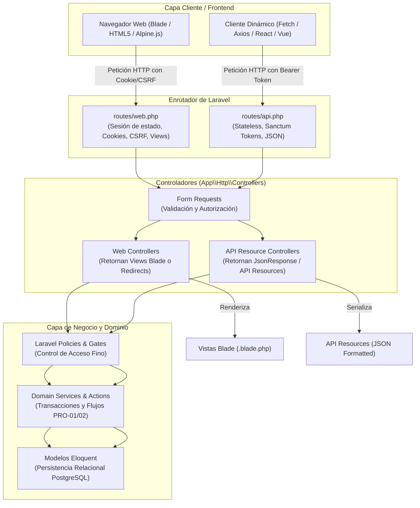

# Workflow y Especificación Canónica de Endpoints SIGPS

Este documento consolida el **flujo de trabajo (workflow)** y la **especificación técnica canónica completa** de rutas web (`routes/web.php`), endpoints API (`routes/api.php`), controladores, Form Requests, políticas y permisos RBAC con Spatie para el **Sistema Integral de Gestión de Proyección Social (SIGPS)** de la Facultad Multidisciplinaria Oriental — Universidad de El Salvador (FMO-UES).

---

## PARTE I: Flujo de Trabajo (Workflow de Construcción y Verificación)

### Paso 1: Identificar el Módulo y Épica en la Especificación
Antes de escribir cualquier línea de código, localiza la sección correspondiente en la Parte II de este documento:
- **SYS-01 (Portal de Administración UPS)**: Sección 3.6 (`role:auxiliar_ups`, `role:jefe_ups`, `role:admin`).
- **SYS-02 (Módulo de Gestión Académica)**:
  - Docente Tutor: Sección 3.4 (`role:tutor`).
  - Coordinador de Carrera: Sección 3.5 (`role:coordinador`).
- **SYS-03 (Portal Estudiantil y Público)**:
  - Estudiante: Sección 3.3 (`role:estudiante`).
  - Público: Sección 3.2 (sin autenticación requerida).
  - Autenticación: Sección 3.1.
- **API RESTful (Integraciones / Clientes dinámicos)**: Sección 4.
- **Mapeo por Historias de Usuario (HU-01 a HU-76)**: Sección 8 (Matriz de trazabilidad ágil).

### Paso 2: Determinar Canal (Web vs API) y Definir Rutas
1. **Canal Web (`routes/web.php`)**:
   - Para interacción por navegador, vistas Blade, formularios HTML con token `@csrf` y cookies de sesión.
   - Utilizar prefijos por rol (`/estudiante`, `/tutor`, `/coordinador`, `/ups`, `/admin`).
   - Aplicar Method Spoofing de Laravel (`@method("PUT")`, `@method("DELETE")`) en formularios convencionales.
   - Asignar nombres de ruta canónicos con `->name("modulo.entidad.accion")`.
2. **Canal API (`routes/api.php`)**:
   - Para peticiones asíncronas (`fetch` / `axios`), integración externa o componentes desacoplados.
   - Prefijo obligatorio `/api/v1/`.
   - Autenticación obligatoria con middleware `auth:sanctum`.
   - Respuestas JSON estructuradas con HTTP status codes canónicos (`200`, `201`, `204`, `400`, `401`, `403`, `404`, `409`, `422`).

### Paso 3: Estructurar el Controlador en su Espacio de Nombres
Crear o ubicar el controlador en su respectivo subdirectorio dentro de `app/Http/Controllers/` según la jerarquía establecida en la sección 2.1:
- `Auth/`: `LoginController`, `ProfileController`.
- `Publico/`: `CatalogoFormatosController`, `VerificacionPublicaController`.
- `Estudiante/`: `ExpedienteEstudianteController`, `EntregaEstudianteController`, `SolicitudProrrogaController`, `SolicitudRetiroController`.
- `Academico/Tutor/`: `TutorDashboardController`, `RevisionTutorController`, `CotejoAsistenciaController`.
- `Academico/Coordinador/`: `CoordinadorDashboardController`, `AsignacionTutorController`, `RevisionCoordinadorController`, `AvalAcademicoController`.
- `Ups/`: `UpsDashboardController`, `BandejaExpedientesController`, `AuditoriaDocumentalController`, `ControlPlazosController`, `GestionProrrogasController`, `CertificacionController`, `EstadisticasController`.
- `Admin/`: `UsuarioController`, `CarreraController`, `AreaConocimientoController`, `FormatoOficialController`, `BitacoraAuditoriaController`.
- `Api/V1/`: `AuthApiController`, `ProyectoApiController`, `EntregaApiController`, `RevisionApiController`, etc.

### Paso 4: Configurar Seguridad y Permisos RBAC (Spatie)
1. Aplicar en rutas o controladores los middlewares de `spatie/laravel-permission`:
   - Rol único: `middleware(["auth", "role:coordinador"])`
   - Múltiples roles: `middleware(["auth", "role:auxiliar_ups|jefe_ups"])`
   - Permiso granular: `middleware(["auth", "permission:certificaciones.emitir"])`
2. En vistas Blade, condicionar acciones con `@role("...")`, `@hasanyrole("...")` o `@can("...")`.
3. Consultar la tabla de roles y permisos atómicos en la sección 2.2 de este documento.

### Paso 5: Implementar Form Requests y Validación
1. No validar directamente en el controlador cuando deba procesarse un formulario o payload complejo:
   - Crear la clase con `php artisan make:request <NombreRequest>`.
   - Implementar método `authorize()` verificando permisos del usuario autenticado.
   - Implementar método `rules()` con las restricciones de tipo, tamaño (e.g. PDF único hasta 10MB en entregas) y catálogos.
2. Validar reglas críticas de negocio (e.g. validación de hash SHA-256 en PDF entregado, motivos obligatorios al observar dictámenes, código único inmutable en avales). Consultar ejemplos en la Sección 5.

### Paso 6: Formatear Respuestas
- **Web**: Retornar `view("modulo.pantalla", $data)` o `redirect()->route("...")->with("success", "...")` / `withErrors(...)`.
- **API**: Retornar `JsonResource` dedicado o `response()->json(["data" => ..., "meta" => ...], StatusCode)`. Consultar esquemas en la Sección 6.

### Paso 7: Validación Mediante Pruebas Automatizadas
1. Crear Feature Test: `php artisan make:test --phpunit <NombreFeatureTest>`.
2. Probar:
   - Acceso con usuario sin rol asignado (espera `403 Forbidden`).
   - Acceso no autenticado (espera redirección a `/login` o `401 Unauthorized`).
   - Acceso con usuario que tiene el rol/permiso correcto (espera `200 OK` o `302 Found`).
   - Envíos con datos inválidos (espera error de validación `422` o redirección con errores).
   - Flujo exitoso de negocio.
3. Ejecutar pruebas con: `vendor/bin/phpunit --filter=<NombreFeatureTest>` o `php artisan test --compact`.

---

## PARTE II: Especificación Técnica y Catálogo Canónico de Endpoints

# Especificación de Endpoints y Rutas MVC en Laravel: Sistema de Proyección Social (SIGPS)
**Facultad Multidisciplinaria Oriental — Universidad de El Salvador (FMO-UES)**  
**Documento Técnico de Arquitectura de Software y Enrutamiento Laravel (Versión 11 / 12)**  

---

## 1. Introducción y Enfoque Arquitectónico

El **Sistema Integral de Gestión de Proyección Social (SIGPS)** está diseñado bajo una arquitectura de **dominio compartido** ([ARQ-01](../lectura/07_arquitectura/componentes.md#arq_01)) que articula tres subsistemas funcionales:
1. **`SYS-01` — Portal de Administración UPS** (Jefatura, Auxiliar/Secretaría, Administrador Técnico).
2. **`SYS-02` — Módulo de Gestión Académica** (Coordinadores de Carrera y Docentes Tutores).
3. **`SYS-03` — Portal Estudiantil y Público** (Estudiantes de la facultad y visitantes públicos).

### 1.1 El Patrón MVC en el Ecosistema Laravel

En Laravel, el patrón **Modelo-Vista-Controlador (MVC)** se implementa distinguiendo con precisión dos canales de interacción según el tipo de consumidor:



1. **Frontend / Rutas Web (`routes/web.php`)**:
   - Orientadas a la interacción directa mediante formularios y navegación web tradicional (o híbrida con Blade + Alpine.js / Livewire / Inertia).
   - Utilizan middleware `web` (soporte de sesiones en servidor, protección contra CSRF con token `@csrf`, cookies cifradas y mensajes flash de sesión).
   - Los métodos de los controladores retornan instancias de `Illuminate\View\View` (vistas Blade) o `Illuminate\Http\RedirectResponse` (`redirect()->route(...)` acompañado de `with('success', '...')` o `withErrors(...)`).
   - Implementan el estándar de **Method Spoofing** de Laravel (`@method('PUT')`, `@method('DELETE')`) para formularios HTML convencionales.

2. **Backend / Rutas API RESTful (`routes/api.php`)**:
   - Orientadas a peticiones asíncronas (`fetch` / `axios`), integración con componentes frontend desacoplados y consumo de datos sin estado (*stateless*).
   - Utilizan middleware `api` y autenticación vía `auth:sanctum` mediante cabecera `Authorization: Bearer {token}`.
   - Retornan payloads estructurados `Illuminate\Http\JsonResponse` mediante clases dedicadas `JsonResource`.
   - Aplican códigos de estado HTTP rigurosos (`200 OK`, `201 Created`, `204 No Content`, `400 Bad Request`, `401 Unauthorized`, `403 Forbidden`, `404 Not Found`, `409 Conflict`, `422 Unprocessable Content`).

---

## 2. Mapa Global de Convenciones y Estructura de Directorios

### 2.1 Espacios de Nombres de Controladores
```text
app/Http/Controllers/
├── Auth/
│   ├── LoginController.php
│   └── ProfileController.php
├── Publico/
│   ├── CatalogoFormatosController.php
│   └── VerificacionPublicaController.php
├── Estudiante/
│   ├── ExpedienteEstudianteController.php
│   ├── EntregaEstudianteController.php
│   ├── SolicitudProrrogaController.php
│   └── SolicitudRetiroController.php
├── Academico/
│   ├── Tutor/
│   │   ├── TutorDashboardController.php
│   │   ├── RevisionTutorController.php
│   │   └── CotejoAsistenciaController.php
│   └── Coordinador/
│       ├── CoordinadorDashboardController.php
│       ├── AsignacionTutorController.php
│       ├── RevisionCoordinadorController.php
│       └── AvalAcademicoController.php
├── Ups/
│   ├── UpsDashboardController.php
│   ├── BandejaExpedientesController.php
│   ├── AuditoriaDocumentalController.php
│   ├── ControlPlazosController.php
│   ├── GestionProrrogasController.php
│   ├── CertificacionController.php
│   └── EstadisticasController.php
├── Admin/
│   ├── UsuarioController.php
│   ├── CarreraController.php
│   ├── AreaConocimientoController.php
│   ├── FormatoOficialController.php
│   └── BitacoraAuditoriaController.php
└── Api/
    └── V1/
        ├── AuthApiController.php
        ├── ProyectoApiController.php
        ├── EntregaApiController.php
        ├── RevisionApiController.php
        ├── AvalApiController.php
        ├── AsistenciaApiController.php
        ├── CertificacionApiController.php
        └── AuditoriaApiController.php
```

### 2.2 Control de Acceso y Autorización con Spatie (`spatie/laravel-permission`)

La arquitectura de seguridad de estos endpoints está fundamentada en el estándar de la industria para Laravel: **`spatie/laravel-permission`**. Este paquete gestiona el Control de Acceso Basado en Roles y Permisos (RBAC) con persistencia en base de datos y caché optimizada.

#### A. Registro de Middlewares en Laravel 11 / 12 (`bootstrap/app.php`)
En las versiones modernas de Laravel (11 y 12), los middlewares de Spatie se registran como alias dentro del pipeline central de la aplicación:

```php
use Illuminate\Foundation\Application;
use Illuminate\Foundation\Configuration\Middleware;

return Application::configure(basePath: dirname(__DIR__))
    ->withRouting(
        web: __DIR__.'/../routes/web.php',
        api: __DIR__.'/../routes/api.php',
        commands: __DIR__.'/../routes/console.php',
        health: '/up',
    )
    ->withMiddleware(function (Middleware $middleware) {
        // Alias de Spatie Laravel-Permission
        $middleware->alias([
            'role'               => \Spatie\Permission\Middleware\RoleMiddleware::class,
            'permission'         => \Spatie\Permission\Middleware\PermissionMiddleware::class,
            'role_or_permission' => \Spatie\Permission\Middleware\RoleOrPermissionMiddleware::class,
        ]);
    })
    ->withExceptions(function ($exceptions) {
        //
    })->create();
```

#### B. Modelo de Usuario (`App\Models\User.php`)
El modelo `User` incorpora el trait `HasRoles` de Spatie, habilitando la verificación fluida tanto en controladores como en directivas de vistas:

```php
namespace App\Models;

use Illuminate\Foundation\Auth\User as Authenticatable;
use Spatie\Permission\Traits\HasRoles;
use Laravel\Sanctum\HasApiTokens;

class User extends Authenticatable
{
    use HasApiTokens, HasRoles;

    protected $guard_name = ['web', 'sanctum']; // Soporte multi-guard
    // ...
}
```

#### C. Matriz de Roles y Permisos Atómicos de Spatie en SIGPS

| Rol en Spatie (`role`) | Actor del Dominio | Permisos Granulares Asociados (`permission`) | Middleware Utilizado en Rutas |
|---|---|---|---|
| `admin` | `ACT-ADMIN` | `usuarios.crear`, `usuarios.editar`, `usuarios.desactivar`, `carreras.gestionar`, `areas.gestionar`, `plantillas.gestionar`, `auditoria.consultar` | `role:admin` |
| `jefe_ups` | `ACT-UPS` | `expedientes.auditar`, `expedientes.aprobar`, `expedientes.observar`, `plazos.consultar`, `prorrogas.resolver`, `certificaciones.emitir`, `estadisticas.exportar` | `role:jefe_ups` |
| `auxiliar_ups` | `ACT-AUX` | `expedientes.auditar`, `expedientes.observar`, `estudiantes.buscar`, `certificaciones.registrar_entrega`, `estadisticas.consultar` | `role:auxiliar_ups` |
| `coordinador` | `ACT-COORD` | `tutores.asignar`, `tutores.reasignar`, `expedientes.revisar_carrera`, `avales.emitir`, `avales.remitir_ups` | `role:coordinador` |
| `tutor` | `ACT-TUTOR` | `expedientes.revisar_tutor`, `expedientes.dictaminar_tutor`, `asistencia.cotejar_f3_f7` | `role:tutor` |
| `estudiante` | `ACT-EST` | `proyectos.inscribir`, `versiones.subir`, `versiones.descargar`, `prorrogas.solicitar`, `retiros.solicitar`, `expediente.consultar` | `role:estudiante` |

#### D. Sintaxis Aplicada en Rutas Web y API con Spatie

1. **Protección por Rol Único**:
   ```php
   Route::middleware(['auth', 'role:coordinador'])->prefix('coordinador')->group(...);
   ```

2. **Protección por Roles Múltiples (Operador OR)**:
   Para rutas compartidas entre Auxiliares y Jefatura de la UPS:
   ```php
   Route::middleware(['auth', 'role:auxiliar_ups|jefe_ups'])->prefix('ups')->group(...);
   ```

3. **Protección por Permiso Granular (`permission`)**:
   En endpoints donde la acción específica requiere privilegios de firma o resolución ejecutiva:
   ```php
   Route::post('/ups/prorrogas/{id}/resolver', [GestionProrrogasController::class, 'resolver'])
       ->middleware(['auth', 'permission:prorrogas.resolver']);

   Route::post('/ups/certificaciones/{id}/emitir', [CertificacionController::class, 'emitir'])
       ->middleware(['auth', 'permission:certificaciones.emitir']);
   ```

4. **Directivas Blade en Vistas Frontend (MVC)**:
   ```blade
   @role('coordinador')
       <a href="{{ route('coordinador.asignaciones.index') }}">Asignar Tutores</a>
   @endrole

   @hasanyrole('auxiliar_ups|jefe_ups')
       <span class="badge badge-info">Panel Operativo UPS</span>
   @endhasanyrole

   @can('avales.emitir')
       <button class="btn btn-success">Emitir Aval Académico</button>
   @endcan
   ```

---


## 3. Catálogo de Rutas Web / Frontend MVC (`routes/web.php`)

Estas rutas gestionan el ciclo de renderizado de vistas Blade, navegación entre pantallas y envíos de formularios protegidos con CSRF.

### 3.1 Módulo Común: Autenticación y Perfil (`RF-COM-01`, `INT-01`)
| Método | URI | Nombre de Ruta (`route()`) | Controlador y Acción | Middleware | Descripción y Vista Blade Retornada |
|---|---|---|---|---|---|
| `GET` | `/login` | `login` | `Auth\LoginController@showLoginForm` | `guest` | Retorna vista `auth.login` (formulario institucional). |
| `POST` | `/login` | `login.attempt` | `Auth\LoginController@login` | `guest`, `throttle:5,1` | Valida credenciales, regenera sesión y redirige al dashboard según rol. |
| `POST` | `/logout` | `logout` | `Auth\LoginController@logout` | `auth` | Invalida sesión, regenera token CSRF y redirige a `/login`. |
| `GET` | `/perfil` | `perfil.edit` | `Auth\ProfileController@edit` | `auth` | Retorna vista `auth.perfil` para actualizar datos personales/contacto. |
| `PUT` | `/perfil` | `perfil.update` | `Auth\ProfileController@update` | `auth` | Procesa cambio de datos o actualización de contraseña. |

---

### 3.2 Módulo Público: Catálogo de Formatos y Verificación (`ACT-PUBLICO`, `RF-COM-02`, `INT-05`)
| Método | URI | Nombre de Ruta | Controlador y Acción | Middleware | Descripción y Vista Blade Retornada |
|---|---|---|---|---|---|
| `GET` | `/` | `home` | `Publico\CatalogoFormatosController@index` | `web` | Página de bienvenida institucional y acceso rápido a formatos oficiales. |
| `GET` | `/formatos-oficiales` | `publico.formatos.index` | `Publico\CatalogoFormatosController@catalogo` | `web` | Retorna vista `publico.formatos` con lista de formatos vigentes (F1 a F7). |
| `GET` | `/formatos-oficiales/{id}/descargar` | `publico.formatos.descargar` | `Publico\CatalogoFormatosController@descargar` | `web` | Descarga directa del archivo de plantilla oficial (`response()->download()`). |
| `GET` | `/verificar-documento` | `publico.verificar.index` | `Publico\VerificacionPublicaController@index` | `web` | Retorna vista `publico.verificar` con buscador de aval o certificación. |
| `POST` | `/verificar-documento` | `publico.verificar.consultar` | `Publico\VerificacionPublicaController@consultar` | `web`, `throttle:15,1` | Valida código único de verificación y retorna datos de autenticidad. |

---

### 3.3 Módulo Estudiantil (`SYS-03`, `ACT-EST`)
Atiende los requisitos de autoservicio estudiantil ([UI-04](../lectura/08_experiencia/pantallas.md#ui_04), [UI-05](../lectura/08_experiencia/pantallas.md#ui_05)):

| Método | URI | Nombre de Ruta | Controlador y Acción | Middleware | Descripción y Vista Blade / Acción |
|---|---|---|---|---|---|
| `GET` | `/estudiante/dashboard` | `estudiante.dashboard` | `Estudiante\ExpedienteEstudianteController@dashboard` | `auth`, `role:estudiante` | Vista `estudiante.dashboard`: Stepper de avance general, tutor asignado y alertas. |
| `GET` | `/estudiante/inscripcion` | `estudiante.inscripcion.create` | `Estudiante\ExpedienteEstudianteController@crearInscripcion` | `auth`, `role:estudiante` | Vista `estudiante.inscripcion`: Formulario de postulación de proyecto si no posee uno activo ([RF-EST-05](../lectura/03_requisitos/funcionales.md#rf_est_05)). |
| `POST` | `/estudiante/inscripcion` | `estudiante.inscripcion.store` | `Estudiante\ExpedienteEstudianteController@guardarInscripcion` | `auth`, `role:estudiante` | Procesa creación de proyecto en estado `inscripcion` ([PRO-01](../lectura/05_procesos/flujos.md#pro_01)). |
| `GET` | `/estudiante/expediente` | `estudiante.expediente.show` | `Estudiante\ExpedienteEstudianteController@show` | `auth`, `role:estudiante` | Vista `estudiante.expediente`: Detalle completo, historial de versiones y dictámenes. |
| `GET` | `/estudiante/fases/{fase}/entrega` | `estudiante.entrega.show` | `Estudiante\EntregaEstudianteController@show` | `auth`, `role:estudiante` | Vista `estudiante.entrega`: Checklist de requisitos por fase ([RF-EST-02](../lectura/03_requisitos/funcionales.md#rf_est_02)) y área de subida. |
| `POST` | `/estudiante/fases/{fase}/subir-version` | `estudiante.entrega.subir` | `Estudiante\EntregaEstudianteController@subirVersion` | `auth`, `role:estudiante` | Sube **PDF único** escaneado ([RN-01](../lectura/04_reglas/negocio.md#rn_01), [INT-02](../lectura/07_arquitectura/interfaces.md#int_02)), almacena en disco privado y calcula SHA-256. |
| `GET` | `/estudiante/versiones/{versionId}/descargar` | `estudiante.version.descargar` | `Estudiante\EntregaEstudianteController@descargarVersion` | `auth`, `role:estudiante`, `can:view,versionId` | Descarga de forma segura el PDF privado subido por el estudiante. |
| `GET` | `/estudiante/solicitudes/prorroga` | `estudiante.prorroga.create` | `Estudiante\SolicitudProrrogaController@create` | `auth`, `role:estudiante` | Vista `estudiante.solicitudes.prorroga`: Formulario para solicitar extensión de plazo ([RF-UPS-05](../lectura/03_requisitos/funcionales.md#rf_ups_05)). |
| `POST` | `/estudiante/solicitudes/prorroga` | `estudiante.prorroga.store` | `Estudiante\SolicitudProrrogaController@store` | `auth`, `role:estudiante` | Registra solicitud formal de prórroga con justificación adjunta. |
| `GET` | `/estudiante/solicitudes/retiro` | `estudiante.retiro.create` | `Estudiante\SolicitudRetiroController@create` | `auth`, `role:estudiante` | Vista `estudiante.solicitudes.retiro`: Formulario de retiro o renuncia de proyecto ([RF-UPS-04](../lectura/03_requisitos/funcionales.md#rf_ups_04)). |
| `POST` | `/estudiante/solicitudes/retiro` | `estudiante.retiro.store` | `Estudiante\SolicitudRetiroController@store` | `auth`, `role:estudiante` | Procesa solicitud de retiro para evaluación de Jefatura UPS. |

---

### 3.4 Módulo de Gestión Académica: Docente Tutor (`SYS-02`, `ACT-TUTOR`)
Atiende la supervisión técnica y pedagógica directa del servicio social ([UI-06](../lectura/08_experiencia/pantallas.md#ui_06)):

| Método | URI | Nombre de Ruta | Controlador y Acción | Middleware | Descripción y Vista Blade / Acción |
|---|---|---|---|---|---|
| `GET` | `/tutor/dashboard` | `tutor.dashboard` | `Academico\Tutor\TutorDashboardController@index` | `auth`, `role:tutor` | Vista `academico.tutor.dashboard`: Proyectos asignados, entregas pendientes y alertas de 15 días ([RN-02](../lectura/04_reglas/negocio.md#rn_02)). |
| `GET` | `/tutor/proyectos/{proyectoId}` | `tutor.proyectos.show` | `Academico\Tutor\TutorDashboardController@show` | `auth`, `role:tutor`, `can:tutorar,proyectoId` | Vista `academico.tutor.proyecto`: Ficha del proyecto, estudiantes y árbol documental. |
| `GET` | `/tutor/versiones/{versionId}/evaluar` | `tutor.revision.create` | `Academico\Tutor\RevisionTutorController@create` | `auth`, `role:tutor`, `can:revisar,versionId` | Vista `academico.tutor.evaluar`: Visor de PDF integrado y panel de dictamen ([RF-ACA-02](../lectura/03_requisitos/funcionales.md#rf_aca_02)). |
| `POST` | `/tutor/versiones/{versionId}/dictamen` | `tutor.revision.store` | `Academico\Tutor\RevisionTutorController@store` | `auth`, `role:tutor`, `can:revisar,versionId` | Procesa dictamen (Aprobado / Observado). Si es observado, exige motivo obligatorio. |
| `GET` | `/tutor/proyectos/{proyectoId}/cotejo-f3-f7` | `tutor.cotejo.show` | `Academico\Tutor\CotejoAsistenciaController@show` | `auth`, `role:tutor`, `can:tutorar,proyectoId` | Vista `academico.tutor.cotejo`: Matriz de cotejo entre actividades F3 y jornadas F7 ([RF-ACA-04](../lectura/03_requisitos/funcionales.md#rf_aca_04), [RN-05](../lectura/04_reglas/negocio.md#rn_05)). |
| `POST` | `/tutor/proyectos/{proyectoId}/cotejo-f3-f7` | `tutor.cotejo.validar` | `Academico\Tutor\CotejoAsistenciaController@validar` | `auth`, `role:tutor`, `can:tutorar,proyectoId` | Registra conformidad o inconsistencias encontradas en la asistencia. |

---

### 3.5 Módulo de Gestión Académica: Coordinador de Carrera (`SYS-02`, `ACT-COORD`)
Atiende la asignación de tutores, control de carrera y emisión de avales ([RF-ACA-01](../lectura/03_requisitos/funcionales.md#rf_aca_01), [RF-ACA-03](../lectura/03_requisitos/funcionales.md#rf_aca_03), [RF-ACA-05](../lectura/03_requisitos/funcionales.md#rf_aca_05)):

| Método | URI | Nombre de Ruta | Controlador y Acción | Middleware | Descripción y Vista Blade / Acción |
|---|---|---|---|---|---|
| `GET` | `/coordinador/dashboard` | `coordinador.dashboard` | `Academico\Coordinador\CoordinadorDashboardController@index` | `auth`, `role:coordinador` | Vista `academico.coordinador.dashboard`: Proyectos de la carrera sin tutor y entregas con visto bueno de tutor. |
| `GET` | `/coordinador/asignaciones` | `coordinador.asignaciones.index` | `Academico\Coordinador\AsignacionTutorController@index` | `auth`, `role:coordinador` | Vista `academico.coordinador.asignaciones`: Listado de proyectos y carga docente por tutor. |
| `POST` | `/coordinador/proyectos/{proyectoId}/asignar-tutor` | `coordinador.asignaciones.asignar` | `Academico\Coordinador\AsignacionTutorController@asignar` | `auth`, `role:coordinador`, `can:gestionarCarrera,proyectoId` | Asigna formalmente un tutor a un proyecto ([HU-61](../lectura/03_requisitos/historias.md#hu_61)). |
| `POST` | `/coordinador/proyectos/{proyectoId}/reasignar-tutor` | `coordinador.asignaciones.reasignar` | `Academico\Coordinador\AsignacionTutorController@reasignar` | `auth`, `role:coordinador`, `can:gestionarCarrera,proyectoId` | Reasigna tutor conservando histórico previo ([HU-62](../lectura/03_requisitos/historias.md#hu_62), [RN-07](../lectura/04_reglas/negocio.md#rn_07)). |
| `GET` | `/coordinador/versiones/{versionId}/revisar` | `coordinador.revision.create` | `Academico\Coordinador\RevisionCoordinadorController@create` | `auth`, `role:coordinador`, `can:avalar,versionId` | Vista `academico.coordinador.revisar`: Expediente aprobado por tutor listo para aval de carrera ([RN-06](../lectura/04_reglas/negocio.md#rn_06)). |
| `POST` | `/coordinador/versiones/{versionId}/dictamen` | `coordinador.revision.store` | `Academico\Coordinador\RevisionCoordinadorController@store` | `auth`, `role:coordinador`, `can:avalar,versionId` | Dictamina visto bueno de coordinación o retorna observaciones al estudiante. |
| `POST` | `/coordinador/versiones/{versionId}/emitir-aval` | `coordinador.aval.store` | `Academico\Coordinador\AvalAcademicoController@store` | `auth`, `role:coordinador`, `can:avalar,versionId` | Genera código inmutable de Aval Académico ([RN-10](../lectura/04_reglas/negocio.md#rn_10)) y prepara remisión a la UPS. |
| `POST` | `/coordinador/avales/{avalId}/remitir-ups` | `coordinador.aval.remitir` | `Academico\Coordinador\AvalAcademicoController@remitirUps` | `auth`, `role:coordinador`, `can:avalar,avalId` | Envía formalmente el expediente a la bandeja de entrada de la UPS ([PRO-02](../lectura/05_procesos/flujos.md#pro_02)). |

---

### 3.6 Módulo de Administración UPS (`SYS-01`, `ACT-AUX`, `ACT-UPS`)
Atiende la recepción formal, auditoría visual de sellos y tinta azul, plazos y certificaciones ([UI-02](../lectura/08_experiencia/pantallas.md#ui_02), [UI-03](../lectura/08_experiencia/pantallas.md#ui_03), [UI-08](../lectura/08_experiencia/pantallas.md#ui_08)):

| Método | URI | Nombre de Ruta | Controlador y Acción | Middleware | Descripción y Vista Blade / Acción |
|---|---|---|---|---|---|
| `GET` | `/ups/dashboard` | `ups.dashboard` | `Ups\UpsDashboardController@index` | `auth`, `role:auxiliar_ups|jefe_ups` | Vista `ups.dashboard`: Métricas de expedientes pendientes, trámites en alerta crítica y certificaciones. |
| `GET` | `/ups/bandeja` | `ups.bandeja.index` | `Ups\BandejaExpedientesController@index` | `auth`, `role:auxiliar_ups|jefe_ups` | Vista `ups.bandeja`: Bandeja de expedientes remitidos con aval de carrera, filtrable por carrera y fase. |
| `GET` | `/ups/auditoria/{versionId}` | `ups.auditoria.show` | `Ups\AuditoriaDocumentalController@show` | `auth`, `role:auxiliar_ups|jefe_ups` | Vista `ups.auditoria`: Visor documental multipágina para inspección de sellos y tinta azul ([RN-09](../lectura/04_reglas/negocio.md#rn_09)). |
| `POST` | `/ups/auditoria/{versionId}/dictamen` | `ups.auditoria.store` | `Ups\AuditoriaDocumentalController@store` | `auth`, `role:auxiliar_ups|jefe_ups` | Dictamina aprobación institucional o devuelve el expediente con observaciones. |
| `GET` | `/ups/plazos` | `ups.plazos.index` | `Ups\ControlPlazosController@index` | `auth`, `role:auxiliar_ups|jefe_ups` | Vista `ups.plazos`: Tablero de control de plazos (15 días tutor, 3 meses prórroga y 18 meses a Junta) ([RN-02](../lectura/04_reglas/negocio.md#rn_02), [RN-04](../lectura/04_reglas/negocio.md#rn_04)). |
| `GET` | `/ups/prorrogas` | `ups.prorrogas.index` | `Ups\GestionProrrogasController@index` | `auth`, `role:auxiliar_ups|jefe_ups` | Vista `ups.prorrogas`: Solicitudes de extensión ingresadas por estudiantes pendientes de dictamen. |
| `POST` | `/ups/prorrogas/{id}/resolver` | `ups.prorrogas.resolver` | `Ups\GestionProrrogasController@resolver` | `auth`, `role:jefe_ups` | Resuelve formalmente la prórroga concediendo o denegando plazo adicional ([RF-UPS-05](../lectura/03_requisitos/funcionales.md#rf_ups_05)). |
| `GET` | `/ups/certificaciones` | `ups.certificaciones.index` | `Ups\CertificacionController@index` | `auth`, `role:auxiliar_ups|jefe_ups` | Vista `ups.certificaciones`: Expedientes finalizados elegibles para emisión de certificación ([RF-UPS-09](../lectura/03_requisitos/funcionales.md#rf_ups_09), [RN-08](../lectura/04_reglas/negocio.md#rn_08)). |
| `POST` | `/ups/certificaciones/{proyectoId}/emitir` | `ups.certificaciones.emitir` | `Ups\CertificacionController@emitir` | `auth`, `role:jefe_ups` | Emite registro de certificación con número de folio inmutable. |
| `POST` | `/ups/certificaciones/{certId}/entregar` | `ups.certificaciones.entregar` | `Ups\CertificacionController@registrarEntrega` | `auth`, `role:auxiliar_ups|jefe_ups` | Registra constancia de entrega física del documento al estudiante. |
| `GET` | `/ups/estadisticas` | `ups.estadisticas.index` | `Ups\EstadisticasController@index` | `auth`, `role:auxiliar_ups|jefe_ups` | Vista `ups.estadisticas`: Gráficas y tablas de egresados por área de conocimiento y mes ([RF-UPS-10](../lectura/03_requisitos/funcionales.md#rf_ups_10)). |
| `GET` | `/ups/estadisticas/exportar` | `ups.estadisticas.exportar` | `Ups\EstadisticasController@exportar` | `auth`, `role:auxiliar_ups|jefe_ups` | Exporta reporte estadístico en formato Excel / CSV. |

---

### 3.7 Módulo de Administración Técnica del Sistema (`SYS-01`, `ACT-ADMIN`)
Atiende el control de usuarios, roles, catálogos institucionales y bitácora de auditoría ([UI-01](../lectura/08_experiencia/pantallas.md#ui_01)):

| Método | URI | Nombre de Ruta | Controlador y Acción | Middleware | Descripción y Vista Blade / Acción |
|---|---|---|---|---|---|
| `GET` | `/admin/usuarios` | `admin.usuarios.index` | `Admin\UsuarioController@index` | `auth`, `role:admin` | Vista `admin.usuarios.index`: Gestión de cuentas internas, perfiles y estados de activación. |
| `POST` | `/admin/usuarios` | `admin.usuarios.store` | `Admin\UsuarioController@store` | `auth`, `role:admin` | Registra un nuevo usuario interno en el sistema. |
| `PUT` | `/admin/usuarios/{id}/estado` | `admin.usuarios.cambiarEstado` | `Admin\UsuarioController@cambiarEstado` | `auth`, `role:admin` | Activa o desactiva una cuenta impidiendo su acceso inmediato ([RF-COM-01](../lectura/03_requisitos/funcionales.md#rf_com_01)). |
| `GET` | `/admin/carreras` | `admin.carreras.index` | `Admin\CarreraController@index` | `auth`, `role:admin` | Vista `admin.carreras.index`: Catálogo de carreras y asignación de subcoordinador responsable. |
| `POST` | `/admin/carreras/{id}/coordinador` | `admin.carreras.asignarCoordinador` | `Admin\CarreraController@asignarCoordinador` | `auth`, `role:admin` | Asigna al usuario docente que ostenta la coordinación de la carrera. |
| `GET` | `/admin/areas-conocimiento` | `admin.areas.index` | `Admin\AreaConocimientoController@index` | `auth`, `role:admin` | Vista `admin.areas.index`: Catálogo de áreas temáticas institucionales ([RF-UPS-08](../lectura/03_requisitos/funcionales.md#rf_ups_08)). |
| `GET` | `/admin/formatos` | `admin.formatos.index` | `Admin\FormatoOficialController@index` | `auth`, `role:admin` | Vista `admin.formatos.index`: Administración y reemplazo de plantillas oficiales vigentes ([RF-COM-02](../lectura/03_requisitos/funcionales.md#rf_com_02)). |
| `POST` | `/admin/formatos` | `admin.formatos.store` | `Admin\FormatoOficialController@store` | `auth`, `role:admin` | Sube nueva versión de formato oficial invalidando la anterior. |
| `GET` | `/admin/auditoria` | `admin.auditoria.index` | `Admin\BitacoraAuditoriaController@index` | `auth`, `role:admin` | Vista `admin.auditoria.index`: Explorador inmutable de eventos de auditoría ([DAT-05](../lectura/06_datos/modelo.md#dat_05), [ARQ-05](../lectura/07_arquitectura/componentes.md#arq_05)). |

---

## 4. Catálogo de Endpoints Backend RESTful (`routes/api.php`)

Todos los endpoints REST están versionados bajo el prefijo `/api/v1/` y consumen/producen `application/json` (excepto la subida de archivos `multipart/form-data`).

### 4.1 Autenticación y Perfil API
```php
Route::prefix('v1')->group(function () {
    Route::post('/auth/login', [AuthApiController::class, 'login']);
    
    Route::middleware('auth:sanctum')->group(function () {
        Route::post('/auth/logout', [AuthApiController::class, 'logout']);
        Route::get('/auth/me', [AuthApiController::class, 'me']);
    });
});
```

#### POST `/api/v1/auth/login`
- **Request Body (JSON)**:
  ```json
  {
    "email": "estudiante@ues.edu.sv",
    "password": "Password123*"
  }
  ```
- **Responses**:
  - `200 OK`:
    ```json
    {
      "token": "1|qW8eR...9sD",
      "token_type": "Bearer",
      "user": {
        "id": "b3e0d8f7-7b8c-4a3d-9d4a-5f6e7a8b9c0d",
        "nombre_completo": "Carlos René Gómez",
        "rol": "estudiante",
        "carrera_id": "c1a2b3c4-d5e6-7f8a-9b0c-1d2e3f4a5b6c"
      }
    }
    ```
  - `401 Unauthorized`: `{"error": "Credenciales inválidas o cuenta inactiva"}`
  - `422 Unprocessable Content`: Fallo de validación de campos obligatorios.

---

### 4.2 Proyectos y Participaciones (`RF-UPS-02`, `RF-EST-01`, `PRO-01`)
```php
Route::middleware(['auth:sanctum'])->prefix('v1')->group(function () {
    Route::apiResource('proyectos', ProyectoApiController::class);
    Route::get('proyectos/{proyecto}/participantes', [ProyectoApiController::class, 'listarParticipantes']);
    Route::post('proyectos/{proyecto}/participantes', [ProyectoApiController::class, 'agregarParticipante']);
    Route::delete('proyectos/{proyecto}/participantes/{estudianteId}', [ProyectoApiController::class, 'removerParticipante']);
});
```

#### POST `/api/v1/proyectos`
- **Autorización**: `role:estudiante` o `role:auxiliar_ups`.
- **Request Body (JSON)**:
  ```json
  {
    "carrera_id": "c1a2b3c4-d5e6-7f8a-9b0c-1d2e3f4a5b6c",
    "titulo": "Desarrollo del Sistema de Gestión Documental Comunitaria",
    "institucion_beneficiaria": "Alcaldía Municipal de San Miguel",
    "modalidad": "interna",
    "area_conocimiento_id": "a9b8c7d6-e5f4-3a2b-1c0d-e9f8a7b6c5d4",
    "estudiantes_carnets": ["GG20015", "MM19042"]
  }
  ```
- **Responses**:
  - `201 Created`: Retorna recurso `ProyectoResource` en estado inicial `inscripcion`.
  - `409 Conflict`: Si algún estudiante ya cuenta con un proyecto activo simultáneo ([RN-08](../lectura/04_reglas/negocio.md#rn_08)).
  - `422 Unprocessable Content`: Carnets no elegibles o campos vacíos.

---

### 4.3 Gestión Documental y Carga de PDF Único (`RF-EST-03`, `RN-01`, `INT-02`)
```php
Route::middleware(['auth:sanctum'])->prefix('v1')->group(function () {
    Route::get('proyectos/{proyecto}/entregas', [EntregaApiController::class, 'index']);
    Route::get('proyectos/{proyecto}/entregas/{fase}', [EntregaApiController::class, 'show']);
    Route::post('entregas/{entrega}/versiones', [EntregaApiController::class, 'subirVersion']);
    Route::get('versiones/{version}/descargar', [EntregaApiController::class, 'descargarArchivo']);
});
```

#### POST `/api/v1/entregas/{entregaId}/versiones`
- **Encabezados**: `Content-Type: multipart/form-data`
- **Autorización**: `role:estudiante`, `can:update,entregaId`
- **Payload (`multipart/form-data`)**:
  - `archivo_pdf`: Archivo binario (MIME `application/pdf`, máx. 15MB).
  - `checklist_items`: Array JSON `["formato_firmado", "constancia_aprobada", "bitacora_sellada"]`.
  - `version_esperada`: Número entero que previene colisiones concurrentes (Optimistic Locking).
- **Lógica en el Controlador de Laravel**:
  1. Verifica que el checklist de la fase esté completo al 100% ([RF-EST-02](../lectura/03_requisitos/funcionales.md#rf_est_02)).
  2. Valida la firma mágica del PDF (cabecera `%PDF-`).
  3. Computa `sha256` inmutable del archivo recibido.
  4. Almacena en almacenamiento privado (`Storage::disk('expedientes_privados')->putFileAs(...)`).
  5. Inserta registro en tabla `version_documental` con `estado_version = 'pendiente_tutor'` ([PRO-02](../lectura/05_procesos/flujos.md#pro_02)).
  6. Dispara evento `VersionSubidaEvent` para iniciar el cronómetro de 15 días del tutor ([RN-02](../lectura/04_reglas/negocio.md#rn_02)).
- **Responses**:
  - `201 Created`:
    ```json
    {
      "version_id": "d4e5f6a7-b8c9-0d1e-2f3a-4b5c6d7e8f9a",
      "numero_version": 2,
      "archivo_hash_sha256": "e3b0c44298fc1c149afbf4c8996fb92427ae41e4649b934ca495991b7852b855",
      "estado_version": "pendiente_tutor",
      "fecha_subida": "2026-10-21T14:30:00Z"
    }
    ```
  - `409 Conflict`: Si `version_esperada` no coincide con el último número registrado.
  - `413 Payload Too Large`: Si el archivo supera los 15MB reglamentarios.
  - `415 Unsupported Media Type`: Si no es un PDF legítimo.
  - `422 Unprocessable Content`: Checklist incompleto.

---

### 4.4 Revisiones Docentes y Dictamen Escalonado (`RF-ACA-02`, `RF-ACA-03`, `RN-06`, `INT-03`)
```php
Route::middleware(['auth:sanctum'])->prefix('v1')->group(function () {
    Route::post('versiones/{version}/dictamen-tutor', [RevisionApiController::class, 'dictaminarTutor']);
    Route::post('versiones/{version}/dictamen-coordinador', [RevisionApiController::class, 'dictaminarCoordinador']);
    Route::post('versiones/{version}/dictamen-ups', [RevisionApiController::class, 'dictaminarUps']);
    Route::get('versiones/{version}/historial-revisiones', [RevisionApiController::class, 'historial']);
});
```

#### POST `/api/v1/versiones/{versionId}/dictamen-tutor`
- **Autorización**: `role:tutor`, `can:revisar,versionId`
- **Request Body (JSON)**:
  ```json
  {
    "resultado": "observado",
    "observaciones": "El apartado 3.2 de objetivos específicos no es medible. Corregir y sellar hoja F3.",
    "version_esperada": 1
  }
  ```
- **Responses**:
  - `200 OK`:
    ```json
    {
      "revision_id": "a1b2c3d4-e5f6-7a8b-9c0d-1e2f3a4b5c6d",
      "resultado": "observado",
      "nuevo_estado_version": "observado",
      "fecha_revision": "2026-10-21T15:00:00Z"
    }
    ```
  - `403 Forbidden`: Revisor no asignado o rol no correspondiente.
  - `409 Conflict`: La versión ya fue dictaminada previamente por este actor.
  - `422 Unprocessable Content`: `observaciones` es obligatorio cuando `resultado = 'observado'`.

#### POST `/api/v1/versiones/{versionId}/dictamen-coordinador`
- **Regla de Negocio Crítica ([RN-06](../lectura/04_reglas/negocio.md#rn_06))**: El backend verifica mediante Eloquent que exista un registro previo de `revision_academica` con `rol_actuante = 'tutor'` y `resultado = 'aprobado'`. Si no existe, deniega con `409 Conflict` ("No se puede dictaminar sin aprobación previa del tutor asignado").

---

### 4.5 Emisión de Aval Académico Inmutable (`RF-ACA-05`, `RN-10`, `INT-03`)
```php
Route::middleware(['auth:sanctum', 'role:coordinador'])->prefix('v1')->group(function () {
    Route::post('versiones/{version}/aval', [AvalApiController::class, 'emitir']);
    Route::post('avales/{aval}/remitir-ups', [AvalApiController::class, 'remitirUps']);
});
```

#### POST `/api/v1/versiones/{versionId}/aval`
- **Request Body (JSON)**:
  ```json
  {
    "observacion_adicional": "Cumple con los requisitos académicos del departamento de Ingeniería."
  }
  ```
- **Responses**:
  - `201 Created`:
    ```json
    {
      "aval_id": "f1e2d3c4-b5a6-7890-1234-56789abcdef0",
      "codigo_verificacion": "AVAL-2026-ING-00142",
      "fecha_emision": "2026-10-21T15:30:00Z",
      "remitido_a_ups": false,
      "firma_hash": "a8f5f167f44f4964e6c998dee827110c"
    }
    ```
  - `409 Conflict`: Versión no aprobada por coordinación o aval ya emitido previamente.

---

### 4.6 Cotejo de Asistencia y Cronograma F3 vs F7 (`RF-ACA-04`, `RN-05`)
```php
Route::middleware(['auth:sanctum', 'role:tutor|coordinador'])->prefix('v1')->group(function () {
    Route::get('proyectos/{proyecto}/asistencia/resumen-f3-f7', [AsistenciaApiController::class, 'resumenCotejo']);
    Route::post('proyectos/{proyecto}/asistencia/cotejar', [AsistenciaApiController::class, 'registrarCotejo']);
    Route::get('proyectos/{proyecto}/asistencia/jornadas', [AsistenciaApiController::class, 'listarJornadas']);
});
```

#### GET `/api/v1/proyectos/{proyectoId}/asistencia/resumen-f3-f7`
- **Responses**:
  - `200 OK`:
    ```json
    {
      "proyecto_id": "9a8b7c6d-5e4f-3a2b-1c0d-e9f8a7b6c5d4",
      "horas_planificadas_f3": 500,
      "horas_reportadas_f7": 512,
      "diferencia_horas": 12,
      "discrepancias_detectadas": [
        {
          "fecha": "2026-08-15",
          "tipo": "fecha_fuera_de_rango",
          "descripcion": "Jornada registrada en día feriado nacional no estipulado en F3"
        }
      ],
      "apto_para_avance": true
    }
    ```

---

### 4.7 Certificaciones y Cierre de Expediente (`RF-UPS-09`, `RN-08`)
```php
Route::middleware(['auth:sanctum', 'role:jefe_ups|auxiliar_ups'])->prefix('v1')->group(function () {
    Route::get('certificaciones', [CertificacionApiController::class, 'index']);
    Route::get('certificaciones/verificar-elegibilidad/{estudianteId}', [CertificacionApiController::class, 'verificarElegibilidad']);
    Route::post('certificaciones', [CertificacionApiController::class, 'emitir']);
    Route::patch('certificaciones/{certificacion}/marcar-entregada', [CertificacionApiController::class, 'marcarEntregada']);
});
```

#### POST `/api/v1/certificaciones`
- **Request Body (JSON)**:
  ```json
  {
    "proyecto_id": "9a8b7c6d-5e4f-3a2b-1c0d-e9f8a7b6c5d4",
    "estudiante_id": "b3e0d8f7-7b8c-4a3d-9d4a-5f6e7a8b9c0d",
    "numero_folio": "FOL-2026-UPS-0089",
    "fecha_emision": "2026-10-21"
  }
  ```
- **Responses**:
  - `201 Created`: Certificación formal registrada con código de verificación QR.
  - `409 Conflict`: Si el proyecto no tiene estado `finalizado` o alguna fase carece de visto bueno UPS.
  - `422 Unprocessable Content`: Número de folio duplicado o estudiante con horas incompletas.

---

### 4.8 Auditoría Inmutable del Dominio (`RF-COM-03`, `ARQ-05`, `DAT-05`)
```php
Route::middleware(['auth:sanctum', 'role:admin'])->prefix('v1')->group(function () {
    Route::get('auditoria/eventos', [AuditoriaApiController::class, 'index']);
    Route::get('auditoria/eventos/{id}', [AuditoriaApiController::class, 'show']);
});
```

---

## 5. Implementación Representativa en Laravel (Código Modelo MVC)

### 5.1 Definición de Rutas Web (`routes/web.php`)
```php
<?php

use Illuminate\Support\Facades\Route;
use App\Http\Controllers\Auth\LoginController;
use App\Http\Controllers\Auth\ProfileController;
use App\Http\Controllers\Publico\CatalogoFormatosController;
use App\Http\Controllers\Publico\VerificacionPublicaController;
use App\Http\Controllers\Estudiante\ExpedienteEstudianteController;
use App\Http\Controllers\Estudiante\EntregaEstudianteController;
use App\Http\Controllers\Academico\Tutor\TutorDashboardController;
use App\Http\Controllers\Academico\Tutor\RevisionTutorController;
use App\Http\Controllers\Academico\Coordinador\CoordinadorDashboardController;
use App\Http\Controllers\Academico\Coordinador\AsignacionTutorController;
use App\Http\Controllers\Academico\Coordinador\RevisionCoordinadorController;
use App\Http\Controllers\Academico\Coordinador\AvalAcademicoController;
use App\Http\Controllers\Ups\UpsDashboardController;
use App\Http\Controllers\Ups\BandejaExpedientesController;
use App\Http\Controllers\Ups\AuditoriaDocumentalController;
use App\Http\Controllers\Ups\CertificacionController;

// 1. Rutas Públicas (Sin Autenticación)
Route::get('/', [CatalogoFormatosController::class, 'index'])->name('home');
Route::get('/formatos-oficiales', [CatalogoFormatosController::class, 'catalogo'])->name('publico.formatos.index');
Route::get('/formatos-oficiales/{id}/descargar', [CatalogoFormatosController::class, 'descargar'])->name('publico.formatos.descargar');
Route::get('/verificar-documento', [VerificacionPublicaController::class, 'index'])->name('publico.verificar.index');
Route::post('/verificar-documento', [VerificacionPublicaController::class, 'consultar'])->name('publico.verificar.consultar');

// 2. Autenticación Clásica
Route::middleware('guest')->group(function () {
    Route::get('/login', [LoginController::class, 'showLoginForm'])->name('login');
    Route::post('/login', [LoginController::class, 'login'])->name('login.attempt');
});

Route::middleware('auth')->group(function () {
    Route::post('/logout', [LoginController::class, 'logout'])->name('logout');
    Route::get('/perfil', [ProfileController::class, 'edit'])->name('perfil.edit');
    Route::put('/perfil', [ProfileController::class, 'update'])->name('perfil.update');

    // 3. Portal Estudiantil (SYS-03)
    Route::middleware('role:estudiante')->prefix('estudiante')->name('estudiante.')->group(function () {
        Route::get('/dashboard', [ExpedienteEstudianteController::class, 'dashboard'])->name('dashboard');
        Route::get('/expediente', [ExpedienteEstudianteController::class, 'show'])->name('expediente.show');
        Route::get('/fases/{fase}/entrega', [EntregaEstudianteController::class, 'show'])->name('entrega.show');
        Route::post('/fases/{fase}/subir-version', [EntregaEstudianteController::class, 'subirVersion'])->name('entrega.subir');
        Route::get('/versiones/{versionId}/descargar', [EntregaEstudianteController::class, 'descargarVersion'])->name('version.descargar');
    });

    // 4. Módulo de Gestión Académica (SYS-02) - Docente Tutor
    Route::middleware('role:tutor')->prefix('tutor')->name('tutor.')->group(function () {
        Route::get('/dashboard', [TutorDashboardController::class, 'index'])->name('dashboard');
        Route::get('/versiones/{versionId}/evaluar', [RevisionTutorController::class, 'create'])->name('revision.create');
        Route::post('/versiones/{versionId}/dictamen', [RevisionTutorController::class, 'store'])->name('revision.store');
    });

    // 5. Módulo de Gestión Académica (SYS-02) - Coordinador de Carrera
    Route::middleware('role:coordinador')->prefix('coordinador')->name('coordinador.')->group(function () {
        Route::get('/dashboard', [CoordinadorDashboardController::class, 'index'])->name('dashboard');
        Route::get('/asignaciones', [AsignacionTutorController::class, 'index'])->name('asignaciones.index');
        Route::post('/proyectos/{proyectoId}/asignar-tutor', [AsignacionTutorController::class, 'asignar'])->name('asignaciones.asignar');
        Route::get('/versiones/{versionId}/revisar', [RevisionCoordinadorController::class, 'create'])->name('revision.create');
        Route::post('/versiones/{versionId}/dictamen', [RevisionCoordinadorController::class, 'store'])->name('revision.store');
        Route::post('/versiones/{versionId}/emitir-aval', [AvalAcademicoController::class, 'store'])->name('aval.store');
        Route::post('/avales/{avalId}/remitir-ups', [AvalAcademicoController::class, 'remitirUps'])->name('aval.remitir');
    });

    // 6. Portal UPS (SYS-01) - Auxiliar y Jefatura
    Route::middleware('role:auxiliar_ups|jefe_ups')->prefix('ups')->name('ups.')->group(function () {
        Route::get('/dashboard', [UpsDashboardController::class, 'index'])->name('dashboard');
        Route::get('/bandeja', [BandejaExpedientesController::class, 'index'])->name('bandeja.index');
        Route::get('/auditoria/{versionId}', [AuditoriaDocumentalController::class, 'show'])->name('auditoria.show');
        Route::post('/auditoria/{versionId}/dictamen', [AuditoriaDocumentalController::class, 'store'])->name('auditoria.store');
        Route::get('/certificaciones', [CertificacionController::class, 'index'])->name('certificaciones.index');
        Route::post('/certificaciones/{proyectoId}/emitir', [CertificacionController::class, 'emitir'])->name('certificaciones.emitir');
    });
});
```

---

### 5.2 Controlador Web Representativo: `EntregaEstudianteController.php`
Ejemplifica el manejo clásico de MVC en Laravel con validación, transacciones, eventos y redirección con mensajes flash:

```php
namespace App\Http\Controllers\Estudiante;

use App\Http\Controllers\Controller;
use App\Http\Requests\SubirVersionDocumentalRequest;
use App\Models\EntregaFase;
use App\Models\VersionDocumental;
use App\Services\AuditoriaService;
use Illuminate\Http\RedirectResponse;
use Illuminate\Support\Facades\DB;
use Illuminate\Support\Facades\Storage;
use Illuminate\View\View;

class EntregaEstudianteController extends Controller
{
    public function show(string $fase): View
    {
        $estudiante = auth()->user();
        $proyecto = $estudiante->proyectoActivoOrFail();

        $entrega = EntregaFase::firstOrCreate(
            ['proyecto_id' => $proyecto->proyecto_id, 'fase' => $fase],
            ['estado_fase' => 'pendiente']
        );

        $checklistConfig = config("sigps.checklist.{$fase}");
        $versiones = $entrega->versiones()->with('revisiones.revisor')->orderByDesc('numero_version')->get();

        return view('estudiante.entrega', compact('proyecto', 'entrega', 'checklistConfig', 'versiones'));
    }

    public function subirVersion(SubirVersionDocumentalRequest $request, string $fase): RedirectResponse
    {
        $estudiante = auth()->user();
        $proyecto = $estudiante->proyectoActivoOrFail();

        $entrega = EntregaFase::where('proyecto_id', $proyecto->proyecto_id)
            ->where('fase', $fase)
            ->firstOrFail();

        // Control de Concurrencia Optimista
        $ultimaVersion = $entrega->versiones()->max('numero_version') ?? 0;
        if ($request->input('version_esperada') != $ultimaVersion) {
            return back()->withErrors(['concurrencia' => 'El expediente ha sido actualizado por otro participante. Recargue la página.']);
        }

        $archivo = $request->file('archivo_pdf');
        $hashSha256 = hash_file('sha256', $archivo->getRealPath());

        DB::transaction(function () use ($request, $entrega, $archivo, $hashSha256, $ultimaVersion, $estudiante) {
            $nuevoNumero = $ultimaVersion + 1;
            $path = $archivo->storeAs(
                "expedientes/{$entrega->proyecto_id}/{$entrega->fase}",
                "v{$nuevoNumero}_{$hashSha256}.pdf",
                'expedientes_privados'
            );

            $version = VersionDocumental::create([
                'entrega_id' => $entrega->entrega_id,
                'numero_version' => $nuevoNumero,
                'archivo_hash_sha256' => $hashSha256,
                'archivo_storage_path' => $path,
                'archivo_tamano_bytes' => $archivo->getSize(),
                'subido_por_id' => $estudiante->usuario_id,
                'checklist_validado' => true,
                'estado_version' => 'pendiente_tutor'
            ]);

            AuditoriaService::registrar([
                'proyecto_id' => $entrega->proyecto_id,
                'usuario_id' => $estudiante->usuario_id,
                'tipo_evento' => 'subida_version_documental',
                'descripcion' => "Carga de versión {$nuevoNumero} para fase {$entrega->fase}"
            ]);
        });

        return redirect()->route('estudiante.entrega.show', $fase)
            ->with('success', 'Documento en PDF cargado exitosamente. Notificado al tutor docente para evaluación.');
    }
}
```

---

### 5.3 Controlador API Representativo: `RevisionApiController.php`
Ejemplifica la lógica de negocio escalonada (`RN-06`), rechazo de versiones obsoletas (`409 Conflict`) y respuestas JSON estructuradas:

```php
namespace App\Http\Controllers\Api\V1;

use App\Http\Controllers\Controller;
use App\Http\Requests\DictamenRevisionRequest;
use App\Models\VersionDocumental;
use App\Models\RevisionAcademica;
use App\Http\Resources\RevisionResource;
use Illuminate\Http\JsonResponse;
use Illuminate\Support\Facades\DB;

class RevisionApiController extends Controller
{
    public function dictaminarTutor(DictamenRevisionRequest $request, string $versionId): JsonResponse
    {
        $version = VersionDocumental::findOrFail($versionId);
        $this->authorize('revisarComoTutor', $version);

        // Control de concurrencia y estado
        if ($version->estado_version !== 'pendiente_tutor') {
            return response()->json([
                'error' => 'Conflict',
                'message' => 'La versión actual no se encuentra en estado pendiente de evaluación por tutor.'
            ], 409);
        }

        $resultado = $request->validated('resultado'); // 'aprobado' | 'observado'
        $observaciones = $request->validated('observaciones');

        $revision = DB::transaction(function () use ($version, $resultado, $observaciones) {
            $nuevoEstado = ($resultado === 'aprobado') ? 'pendiente_coordinador' : 'observado';

            $rev = RevisionAcademica::create([
                'version_id' => $version->version_id,
                'revisor_id' => auth()->id(),
                'rol_actuante' => 'tutor',
                'resultado' => $resultado,
                'observaciones' => $observaciones
            ]);

            $version->update(['estado_version' => $nuevoEstado]);

            return $rev;
        });

        return response()->json([
            'message' => 'Dictamen emitido exitosamente.',
            'data' => new RevisionResource($revision)
        ], 200);
    }

    public function dictaminarCoordinador(DictamenRevisionRequest $request, string $versionId): JsonResponse
    {
        $version = VersionDocumental::findOrFail($versionId);
        $this->authorize('avalarComoCoordinador', $version);

        // RN-06: No se puede dictaminar en coordinación sin aprobación previa del tutor
        $aprobacionTutor = $version->revisiones()
            ->where('rol_actuante', 'tutor')
            ->where('resultado', 'aprobado')
            ->exists();

        if (!$aprobacionTutor) {
            return response()->json([
                'error' => 'Conflict',
                'message' => 'Violación de escalonamiento RN-06: Se requiere la aprobación explícita del tutor antes del aval del coordinador.'
            ], 409);
        }

        // Lógica de dictamen de coordinador...
        return response()->json(['message' => 'Dictamen de coordinación procesado.'], 200);
    }
}
```

---

### 5.4 Form Request de Validación Estricta: `SubirVersionDocumentalRequest.php`
```php
namespace App\Http\Requests;

use Illuminate\Foundation\Http\FormRequest;

class SubirVersionDocumentalRequest extends FormRequest
{
    public function authorize(): bool
    {
        return $this->user() && $this->user()->tieneRol('estudiante');
    }

    public function rules(): array
    {
        return [
            'archivo_pdf' => [
                'required',
                'file',
                'mimes:pdf',
                'max:15360', // 15 Megabytes
            ],
            'version_esperada' => [
                'required',
                'integer',
                'min:0'
            ],
            'checklist_items' => [
                'required',
                'array',
                'min:1'
            ],
            'checklist_items.*' => [
                'string',
                'distinct'
            ]
        ];
    }

    public function messages(): array
    {
        return [
            'archivo_pdf.mimes' => 'El expediente debe entregarse estrictamente en formato PDF legible (RN-01).',
            'archivo_pdf.max' => 'El documento no puede exceder el límite institucional de 15 MB.',
            'checklist_items.required' => 'Debe confirmar el cumplimiento de todos los requisitos de la fase.'
        ];
    }
}
```

---

## 6. Matriz de Códigos de Respuesta HTTP y Manejo de Errores

| Código HTTP | Nombre Estándar | Caso de Uso en SIGPS | Comportamiento en Laravel |
|---|---|---|---|
| `200 OK` | Petición Exitosa | Consultas (`GET`), dictámenes aprobados o actualizaciones sin cambio de entidad. | `return response()->json(...)` o vista Blade renderizada. |
| `201 Created` | Recurso Creado | Creación de proyecto, subida de nueva versión documental (`POST`), o emisión de aval. | Cabecera `Location` opcional y payload del nuevo recurso. |
| `204 No Content` | Sin Contenido | Retiro de participante o desvinculación sin contenido de retorno. | `response()->noContent()` |
| `400 Bad Request` | Petición Malformada | Parámetros inválidos o formato JSON corrompido. | Manejado por `Handler.php` / `bootstrap/app.php`. |
| `401 Unauthorized` | No Autenticado | Token de Sanctum expirado o usuario sin sesión web activa. | Redirección a `route('login')` en web o JSON en API. |
| `403 Forbidden` | Sin Autorización | Intento de acceder al expediente de otro alumno o tutor revisando proyectos de otra carrera. | `abort(403)` vía Laravel Policies. |
| `404 Not Found` | No Encontrado | Carnet, proyecto o versión documental inexistente. | Excepción `ModelNotFoundException` capturada automáticamente. |
| `409 Conflict` | Conflicto de Estado / Concurrencia | Dictamen sobre versión desactualizada o incumplimiento del escalonamiento obligatorio ([RN-06](../lectura/04_reglas/negocio.md#rn_06)). | Respuesta JSON con código de regla violada (`RN-06`, `RN-02`). |
| `413 Payload Too Large` | Tamaño Excedido | Archivo PDF escaneado supera los 15MB. | Directiva web server / `PostTooLargeException`. |
| `415 Unsupported Media Type` | Tipo Inválido | Carga de archivo Word (`.docx`), imagen suelta o ejecutable en vez de PDF. | Validación de regla `mimes:pdf` en FormRequest. |
| `422 Unprocessable Content` | Fallo de Validación | Falta de motivo en dictamen observado o checklist incompleto. | En web redirige con errores; en API retorna array de errores por campo. |

---

## 7. Matriz Exhaustiva de Trazabilidad: 17 Épicas y 76 Historias de Usuario (HU-01 a HU-76)

Esta matriz demuestra la cobertura directa del 100 % de las historias de usuario documentadas en el archivo canónico [`Sistema de Proyección Social.txt`](../Sistema%20de%20Proyeccio%CC%81n%20Social.txt):

### Épica 1: Autenticación y control de acceso interno
| Historia de Usuario | Descripción Funcional | Ruta Web (Blade / MVC) | Endpoint RESTful API | Controlador Laravel Asociado |
|---|---|---|---|---|
| **HU-01** | Inicio de sesión interno | `POST /login` (`login.attempt`) | `POST /api/v1/auth/login` | `Auth\LoginController@login` |
| **HU-02** | Gestión de roles (Admin / Auxiliar) | `POST /admin/usuarios`, `PUT /admin/usuarios/{id}` | `POST /api/v1/admin/usuarios` | `Admin\UsuarioController@store` |
| **HU-03** | Crear, activar o desactivar usuarios | `PUT /admin/usuarios/{id}/estado` | `PATCH /api/v1/admin/usuarios/{id}/estado` | `Admin\UsuarioController@cambiarEstado` |

### Épica 2: Gestión de estudiantes
| Historia de Usuario | Descripción Funcional | Ruta Web (Blade / MVC) | Endpoint RESTful API | Controlador Laravel Asociado |
|---|---|---|---|---|
| **HU-04** | Consultar estudiantes registrados | `GET /ups/bandeja` | `GET /api/v1/ups/estudiantes` | `Ups\BandejaExpedientesController@index` |
| **HU-05** | Buscar estudiantes por carnet/nombre | `GET /ups/bandeja?search={carnet}` | `GET /api/v1/ups/estudiantes?search={query}` | `Ups\BandejaExpedientesController@index` |
| **HU-06** | Filtrar estudiantes por fecha y área | `GET /ups/bandeja?area={id}&fecha={rango}` | `GET /api/v1/ups/estudiantes?area_id={id}` | `Ups\BandejaExpedientesController@index` |

### Épica 3: Gestión de proyectos de horas sociales
| Historia de Usuario | Descripción Funcional | Ruta Web (Blade / MVC) | Endpoint RESTful API | Controlador Laravel Asociado |
|---|---|---|---|---|
| **HU-07** | Registrar proyecto | `POST /estudiante/inscripcion` | `POST /api/v1/proyectos` | `Estudiante\ExpedienteEstudianteController@guardarInscripcion` |
| **HU-08** | Consultar información de proyecto | `GET /estudiante/expediente`, `GET /ups/bandeja/{id}` | `GET /api/v1/proyectos/{id}` | `Estudiante\ExpedienteEstudianteController@show` |
| **HU-09** | Modificar información permitida | `PUT /ups/proyectos/{id}` | `PUT /api/v1/proyectos/{id}` | `Ups\BandejaExpedientesController@update` |
| **HU-10** | Asociar estudiantes al proyecto | `POST /ups/proyectos/{id}/estudiantes` | `POST /api/v1/proyectos/{id}/participantes` | `Api\V1\ProyectoApiController@agregarParticipante` |
| **HU-11** | Identificar proyectos próximos a vencer | `GET /ups/plazos` | `GET /api/v1/ups/plazos/alertas` | `Ups\ControlPlazosController@index` |

### Épica 4: Ciclo de vida del proyecto
| Historia de Usuario | Descripción Funcional | Ruta Web (Blade / MVC) | Endpoint RESTful API | Controlador Laravel Asociado |
|---|---|---|---|---|
| **HU-12** | Gestionar inscripción | `POST /estudiante/fases/inscripcion/subir-version` | `POST /api/v1/entregas/{id}/versiones` | `Estudiante\EntregaEstudianteController@subirVersion` |
| **HU-13** | Gestionar anteproyecto | `POST /estudiante/fases/anteproyecto/subir-version` | `POST /api/v1/entregas/{id}/versiones` | `Estudiante\EntregaEstudianteController@subirVersion` |
| **HU-14** | Gestionar avance del 50 % | `POST /estudiante/fases/avance_50/subir-version` | `POST /api/v1/entregas/{id}/versiones` | `Estudiante\EntregaEstudianteController@subirVersion` |
| **HU-15** | Gestionar memoria final | `POST /estudiante/fases/memoria_final/subir-version` | `POST /api/v1/entregas/{id}/versiones` | `Estudiante\EntregaEstudianteController@subirVersion` |
| **HU-16** | Finalizar proyecto | `POST /ups/proyectos/{id}/finalizar` | `POST /api/v1/proyectos/{id}/finalizar` | `Ups\BandejaExpedientesController@finalizar` |
| **HU-17** | Consultar estado actual del proyecto | `GET /estudiante/dashboard` (Stepper) | `GET /api/v1/proyectos/{id}/estado` | `Estudiante\ExpedienteEstudianteController@dashboard` |
| **HU-18** | Consultar historial cronológico | `GET /estudiante/expediente#historial` | `GET /api/v1/proyectos/{id}/historial` | `Estudiante\ExpedienteEstudianteController@show` |

### Épica 5: Procesos extraordinarios
| Historia de Usuario | Descripción Funcional | Ruta Web (Blade / MVC) | Endpoint RESTful API | Controlador Laravel Asociado |
|---|---|---|---|---|
| **HU-19** | Retirar estudiante de un proyecto | `POST /estudiante/solicitudes/retiro` | `DELETE /api/v1/proyectos/{id}/participantes/{estId}` | `Estudiante\SolicitudRetiroController@store` |
| **HU-20** | Cancelar proyecto | `POST /ups/proyectos/{id}/cancelar` | `POST /api/v1/proyectos/{id}/cancelar` | `Ups\BandejaExpedientesController@cancelar` |
| **HU-21** | Registrar ampliación de plazo | `POST /ups/prorrogas/{id}/resolver` | `POST /api/v1/proyectos/{id}/ampliar-plazo` | `Ups\GestionProrrogasController@resolver` |
| **HU-22** | Registrar prórroga extraordinaria | `POST /estudiante/solicitudes/prorroga` | `POST /api/v1/solicitudes-prorroga` | `Estudiante\SolicitudProrrogaController@store` |
| **HU-23** | Consultar procesos extraordinarios | `GET /ups/prorrogas` | `GET /api/v1/proyectos/{id}/procesos-extraordinarios` | `Ups\GestionProrrogasController@index` |

### Épica 6: Gestión documental
| Historia de Usuario | Descripción Funcional | Ruta Web (Blade / MVC) | Endpoint RESTful API | Controlador Laravel Asociado |
|---|---|---|---|---|
| **HU-24** | Subir documentos del expediente (PDF único) | `POST /estudiante/fases/{fase}/subir-version` | `POST /api/v1/entregas/{id}/versiones` | `Estudiante\EntregaEstudianteController@subirVersion` |
| **HU-25** | Consultar documentos de un proyecto | `GET /estudiante/expediente` | `GET /api/v1/proyectos/{id}/entregas` | `Estudiante\ExpedienteEstudianteController@show` |
| **HU-26** | Descargar documentos privados | `GET /estudiante/versiones/{id}/descargar` | `GET /api/v1/versiones/{id}/descargar` | `Estudiante\EntregaEstudianteController@descargarVersion` |
| **HU-27** | Subir memoria final escaneada | `POST /estudiante/fases/memoria_final/subir-version` | `POST /api/v1/entregas/{id}/versiones` | `Estudiante\EntregaEstudianteController@subirVersion` |

### Épica 7: Gestión de áreas de conocimiento
| Historia de Usuario | Descripción Funcional | Ruta Web (Blade / MVC) | Endpoint RESTful API | Controlador Laravel Asociado |
|---|---|---|---|---|
| **HU-28** | Crear área de conocimiento | `POST /admin/areas-conocimiento` | `POST /api/v1/areas-conocimiento` | `Admin\AreaConocimientoController@store` |
| **HU-29** | Modificar área de conocimiento | `PUT /admin/areas-conocimiento/{id}` | `PUT /api/v1/areas-conocimiento/{id}` | `Admin\AreaConocimientoController@update` |
| **HU-30** | Activar o desactivar área | `PUT /admin/areas-conocimiento/{id}/estado` | `PATCH /api/v1/areas-conocimiento/{id}/estado` | `Admin\AreaConocimientoController@cambiarEstado` |
| **HU-31** | Aplicar cambios a proyectos existentes | `PUT /admin/areas-conocimiento/{id}` (`alcance=retroactivo`) | `PUT /api/v1/areas-conocimiento/{id}` (`retroactivo=true`) | `Admin\AreaConocimientoController@update` |
| **HU-32** | Aplicar cambios solo a proyectos futuros | `PUT /admin/areas-conocimiento/{id}` (`alcance=futuro`) | `PUT /api/v1/areas-conocimiento/{id}` (`retroactivo=false`) | `Admin\AreaConocimientoController@update` |

### Épica 8: Certificación de horas sociales
| Historia de Usuario | Descripción Funcional | Ruta Web (Blade / MVC) | Endpoint RESTful API | Controlador Laravel Asociado |
|---|---|---|---|---|
| **HU-33** | Generar certificación oficial | `POST /ups/certificaciones/{id}/emitir` | `POST /api/v1/certificaciones` | `Ups\CertificacionController@emitir` |
| **HU-34** | Registrar entrega física de certificación | `POST /ups/certificaciones/{id}/entregar` | `PATCH /api/v1/certificaciones/{id}/marcar-entregada` | `Ups\CertificacionController@registrarEntrega` |
| **HU-35** | Consultar historial de certificaciones | `GET /ups/certificaciones` | `GET /api/v1/certificaciones` | `Ups\CertificacionController@index` |
| **HU-36** | Estadísticas mensuales de entrega | `GET /ups/estadisticas?tipo=mensual` | `GET /api/v1/estadisticas/mensual` | `Ups\EstadisticasController@index` |
| **HU-37** | Estadísticas anuales | `GET /ups/estadisticas?tipo=anual` | `GET /api/v1/estadisticas/anual` | `Ups\EstadisticasController@index` |
| **HU-38** | Estadísticas por rango de fechas | `GET /ups/estadisticas?desde={d}&hasta={h}` | `GET /api/v1/estadisticas/rango` | `Ups\EstadisticasController@index` |
| **HU-39** | Estadísticas agrupadas por área | `GET /ups/estadisticas?tipo=area` | `GET /api/v1/estadisticas/area` | `Ups\EstadisticasController@index` |

### Épica 9: Gestión de plantillas
| Historia de Usuario | Descripción Funcional | Ruta Web (Blade / MVC) | Endpoint RESTful API | Controlador Laravel Asociado |
|---|---|---|---|---|
| **HU-40** | Subir nuevas plantillas | `POST /admin/formatos` | `POST /api/v1/admin/formatos` | `Admin\FormatoOficialController@store` |
| **HU-41** | Modificar/actualizar plantillas vigentes | `PUT /admin/formatos/{id}` | `PUT /api/v1/admin/formatos/{id}` | `Admin\FormatoOficialController@update` |
| **HU-42** | Activar o desactivar plantillas | `PUT /admin/formatos/{id}/estado` | `PATCH /api/v1/admin/formatos/{id}/estado` | `Admin\FormatoOficialController@cambiarEstado` |
| **HU-43** | Descargar plantillas oficiales vigentes | `GET /formatos-oficiales/{id}/descargar` | `GET /api/v1/formatos/{id}/descargar` | `Publico\CatalogoFormatosController@descargar` |

### Épica 10: Acceso del estudiante
| Historia de Usuario | Descripción Funcional | Ruta Web (Blade / MVC) | Endpoint RESTful API | Controlador Laravel Asociado |
|---|---|---|---|---|
| **HU-44** | Inicio de sesión del estudiante | `POST /login` | `POST /api/v1/auth/login` | `Auth\LoginController@login` |
| **HU-45** | Consultar mi información académica/personal | `GET /estudiante/dashboard`, `GET /perfil` | `GET /api/v1/auth/me` | `Auth\ProfileController@edit` |
| **HU-46** | Consultar fase actual de mi proyecto | `GET /estudiante/dashboard` | `GET /api/v1/estudiante/proyecto/fase-actual` | `Estudiante\ExpedienteEstudianteController@dashboard` |

### Épica 11: Requisitos del estudiante
| Historia de Usuario | Descripción Funcional | Ruta Web (Blade / MVC) | Endpoint RESTful API | Controlador Laravel Asociado |
|---|---|---|---|---|
| **HU-47** | Consultar requisitos generales de horas | `GET /formatos-oficiales` | `GET /api/v1/requisitos/generales` | `Publico\CatalogoFormatosController@catalogo` |
| **HU-48** | Consultar requisitos específicos por fase | `GET /estudiante/fases/{fase}/entrega` | `GET /api/v1/requisitos/fase/{fase}` | `Estudiante\EntregaEstudianteController@show` |

### Épica 12: Documentación del estudiante
| Historia de Usuario | Descripción Funcional | Ruta Web (Blade / MVC) | Endpoint RESTful API | Controlador Laravel Asociado |
|---|---|---|---|---|
| **HU-49** | Subir documentos de inscripción | `POST /estudiante/fases/inscripcion/subir-version` | `POST /api/v1/entregas/{id}/versiones` | `Estudiante\EntregaEstudianteController@subirVersion` |
| **HU-50** | Subir documentos de cada fase | `POST /estudiante/fases/{fase}/subir-version` | `POST /api/v1/entregas/{id}/versiones` | `Estudiante\EntregaEstudianteController@subirVersion` |
| **HU-51** | Consultar estado de documentos (Pendiente, Aprobado, Observado) | `GET /estudiante/expediente` | `GET /api/v1/proyectos/{id}/entregas` | `Estudiante\ExpedienteEstudianteController@show` |
| **HU-52** | Consultar observaciones recibidas | `GET /estudiante/expediente#observaciones` | `GET /api/v1/versiones/{id}/observaciones` | `Estudiante\ExpedienteEstudianteController@show` |
| **HU-53** | Reemplazar documentos / subsanar versión | `POST /estudiante/fases/{fase}/subir-version` (v+1) | `POST /api/v1/entregas/{id}/versiones` | `Estudiante\EntregaEstudianteController@subirVersion` |

### Épica 13: Formularios y plantillas digitales
| Historia de Usuario | Descripción Funcional | Ruta Web (Blade / MVC) | Endpoint RESTful API | Controlador Laravel Asociado |
|---|---|---|---|---|
| **HU-54** | Llenar formulario de inscripción en línea | `GET /estudiante/inscripcion` | `GET /api/v1/estudiante/formularios/inscripcion` | `Estudiante\ExpedienteEstudianteController@crearInscripcion` |
| **HU-55** | Guardar borrador temporal de formulario | `POST /estudiante/inscripcion/borrador` | `POST /api/v1/estudiante/formularios/borrador` | `Estudiante\ExpedienteEstudianteController@guardarBorrador` |
| **HU-56** | Generar documento digital desde formulario | `POST /estudiante/formularios/generar-pdf` | `POST /api/v1/estudiante/formularios/generar-pdf` | `Estudiante\FormularioPdfController@generar` |
| **HU-57** | Consultar catálogo de plantillas disponibles | `GET /formatos-oficiales` | `GET /api/v1/formatos` | `Publico\CatalogoFormatosController@catalogo` |

### Épica 14: Autenticación y roles externos
| Historia de Usuario | Descripción Funcional | Ruta Web (Blade / MVC) | Endpoint RESTful API | Controlador Laravel Asociado |
|---|---|---|---|---|
| **HU-58** | Inicio de sesión unificado por rol | `POST /login` | `POST /api/v1/auth/login` | `Auth\LoginController@login` |
| **HU-59** | Visualizar menú adaptativo según rol | Vistas Blade con directivas `@role` y `@can` | Atributo `permissions` en payload `/auth/me` | `App\Http\Middleware\EnsureUserHasRole` |

### Épica 15: Gestión de tutores
| Historia de Usuario | Descripción Funcional | Ruta Web (Blade / MVC) | Endpoint RESTful API | Controlador Laravel Asociado |
|---|---|---|---|---|
| **HU-60** | Registrar docentes tutores | `POST /admin/usuarios` (`rol=tutor`) | `POST /api/v1/admin/tutores` | `Admin\UsuarioController@store` |
| **HU-61** | Asignar tutor a un proyecto | `POST /coordinador/proyectos/{id}/asignar-tutor` | `POST /api/v1/coordinador/asignar-tutor` | `Academico\Coordinador\AsignacionTutorController@asignar` |
| **HU-62** | Reasignar tutor conservando histórico | `POST /coordinador/proyectos/{id}/reasignar-tutor` | `POST /api/v1/coordinador/reasignar-tutor` | `Academico\Coordinador\AsignacionTutorController@reasignar` |
| **HU-63** | Consultar proyectos y estudiantes a cargo | `GET /tutor/dashboard` | `GET /api/v1/tutor/proyectos` | `Academico\Tutor\TutorDashboardController@index` |

### Épica 16: Flujo de revisión documental escalonado
| Historia de Usuario | Descripción Funcional | Ruta Web (Blade / MVC) | Endpoint RESTful API | Controlador Laravel Asociado |
|---|---|---|---|---|
| **HU-64** | Enviar documento al tutor asignado | `POST /estudiante/fases/{fase}/subir-version` | `POST /api/v1/entregas/{id}/versiones` | `Estudiante\EntregaEstudianteController@subirVersion` |
| **HU-65** | Revisar documento como tutor | `GET /tutor/versiones/{id}/evaluar` | `GET /api/v1/versiones/{id}` | `Academico\Tutor\RevisionTutorController@create` |
| **HU-66** | Aprobar documento como tutor | `POST /tutor/versiones/{id}/dictamen` (`aprobado`) | `POST /api/v1/versiones/{id}/dictamen-tutor` | `Academico\Tutor\RevisionTutorController@store` |
| **HU-67** | Rechazar/observar documento como tutor | `POST /tutor/versiones/{id}/dictamen` (`observado`) | `POST /api/v1/versiones/{id}/dictamen-tutor` | `Academico\Tutor\RevisionTutorController@store` |
| **HU-68** | Enviar documento aprobado al coordinador | Transición interna a `pendiente_coordinador` | Transición de estado en BD | `Academico\Tutor\RevisionTutorController@store` |
| **HU-69** | Revisar documento como coordinador | `GET /coordinador/versiones/{id}/revisar` | `GET /api/v1/versiones/{id}` | `Academico\Coordinador\RevisionCoordinadorController@create` |
| **HU-70** | Aprobar documento como coordinador y aval | `POST /coordinador/versiones/{id}/emitir-aval` | `POST /api/v1/versiones/{id}/aval` | `Academico\Coordinador\AvalAcademicoController@store` |
| **HU-71** | Rechazar/observar como coordinador | `POST /coordinador/versiones/{id}/dictamen` (`observado`) | `POST /api/v1/versiones/{id}/dictamen-coordinador` | `Academico\Coordinador\RevisionCoordinadorController@store` |
| **HU-72** | Remitir documento avalado a UPS | `POST /coordinador/avales/{id}/remitir-ups` | `POST /api/v1/avales/{id}/remitir-ups` | `Academico\Coordinador\AvalAcademicoController@remitirUps` |

### Épica 17: Seguimiento y trazabilidad
| Historia de Usuario | Descripción Funcional | Ruta Web (Blade / MVC) | Endpoint RESTful API | Controlador Laravel Asociado |
|---|---|---|---|---|
| **HU-73** | Consultar historial de revisiones | `GET /estudiante/expediente` | `GET /api/v1/versiones/{id}/historial-revisiones` | `RevisionApiController@historial` |
| **HU-74** | Consultar observaciones históricas | `GET /estudiante/expediente#observaciones` | `GET /api/v1/versiones/{id}/observaciones` | `RevisionApiController@observaciones` |
| **HU-75** | Consultar responsable de cada revisión | Atributo `revisor.nombre` en vistas Blade | Campo `revisor` en `RevisionResource` | Modelos Eloquent (`RevisionAcademica`) |
| **HU-76** | Consultar fecha y hora de cada acción | Timestamps formateados con Carbon | Timestamps ISO-8601 en JSON (`fecha_revision`) | Modelos Eloquent (`RevisionAcademica`) |

