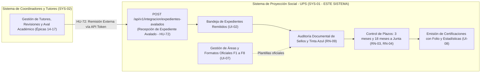

# Workflow y Especificación Canónica de Endpoints SIGPS (UPS — SYS-01)

Este documento consolida el **flujo de trabajo (workflow)** y la **especificación técnica canónica completa** de rutas web (`routes/web.php`), endpoints API (`routes/api.php`), controladores, Form Requests, políticas y permisos RBAC con Spatie para el **Sistema de Proyección Social (UPS — SYS-01)** de la Facultad Multidisciplinaria Oriental — Universidad de El Salvador (FMO-UES).

> [!IMPORTANT]
> **DELIMITACIÓN DE ARQUITECTURA ([ADR-06])**:
> Este repositorio y este workflow corresponden **exclusivamente al Backoffice de la Unidad de Proyección Social (UPS — SYS-01)**.
> El Sistema de Coordinadores y Tutores (`SYS-02`) y el Portal Estudiantil operan de forma separada. El único punto de contacto entre ambos sistemas es la API de integración:
> `POST /api/v1/integracion/expedientes-avalados` ([HU-72]).

---

## PARTE I: Flujo de Trabajo (Workflow de Construcción y Verificación)

### Paso 1: Identificar el Módulo y Épica en la Especificación
Antes de escribir cualquier línea de código, localiza la sección correspondiente en la Parte II de este documento:
- **Módulo 1: Autenticación y Control de Acceso Interno**: [Sección 3.1](#31-módulo-1-autenticación-y-control-de-acceso-interno-épica-1) (Épica 1 / HU-01 a HU-03).
- **Módulo 2: Gestión de Estudiantes**: [Sección 3.2](#32-módulo-2-gestión-de-estudiantes-épica-2) (Épica 2 / HU-04 a HU-06).
- **Módulo 3: Gestión de Proyectos de Horas Sociales**: [Sección 3.3](#33-módulo-3-gestión-de-proyectos-de-horas-sociales-épica-3) (Épica 3 / HU-07 a HU-11).
- **Módulo 4: Ciclo de Vida del Proyecto y Bandeja UPS**: [Sección 3.4](#34-módulo-4-ciclo-de-vida-del-proyecto-y-bandeja-ups-épica-4) (Épica 4 / HU-12 a HU-18).
- **Módulo 5: Procesos Extraordinarios y Plazos**: [Sección 3.5](#35-módulo-5-procesos-extraordinarios-y-plazos-épica-5) (Épica 5 / HU-19 a HU-23).
- **Módulo 6: Auditoría Documental de Sellos y Tinta Azul**: [Sección 3.6](#36-módulo-6-auditoría-documental-de-sellos-y-tinta-azul-épica-6) (Épica 6 / HU-24 a HU-27).
- **Módulo 7: Gestión de Áreas de Conocimiento**: [Sección 3.7](#37-módulo-7-gestión-de-áreas-de-conocimiento-épica-7) (Épica 7 / HU-28 a HU-32).
- **Módulo 8: Certificación de Horas Sociales y Estadísticas**: [Sección 3.8](#38-módulo-8-certificación-de-horas-sociales-y-estadísticas-épica-8) (Épica 8 / HU-33 a HU-39).
- **Módulo 9: Gestión de Plantillas Oficiales**: [Sección 3.9](#39-módulo-9-gestión-de-plantillas-oficiales-épica-9) (Épica 9 / HU-40 a HU-43).
- **Módulo 10: Administración Técnica de Usuarios y Auditoría**: [Sección 3.10](#310-administración-técnica-de-usuarios-y-auditoría-sys-01-act-admin).
- **API RESTful y Punto de Integración Externa ([HU-72])**: [Sección 4](#4-catálogo-de-endpoints-backend-restful-api-routesapiphp).
- **Matriz de Trazabilidad HU-01 a HU-43**: [Sección 6](#6-matriz-exhaustiva-de-trazabilidad-épicas-1-a-9-del-sistema-de-proyección-social-hu-01-a-hu-43).

### Paso 2: Determinar Canal (Web vs API) y Definir Rutas
1. **Canal Web (`routes/web.php`)**:
   - Para la interfaz operativa de la UPS mediante vistas Blade, cookies de sesión y formularios con token `@csrf`.
   - Agrupación por prefijos:
     - `/ups`: Rutas operativas protegidas con `middleware("role:auxiliar_ups|jefe_ups")`.
     - `/admin`: Rutas de configuración protegidas con `middleware("role:admin")`.
   - Nombres canónicos de ruta: `ups.bandeja.index`, `ups.auditoria.show`, `admin.usuarios.index`, etc.
2. **Canal API RESTful (`routes/api.php`)**:
   - Prefijo obligatorio `/api/v1/ups/` protegido con `auth:sanctum`.
   - Punto de integración externo: `POST /api/v1/integracion/expedientes-avalados` con token de carrera (`carrera-service-token`).
   - Respuestas JSON estructuradas con códigos HTTP estándar (`200 OK`, `201 Created`, `401 Unauthorized`, `409 Conflict`, `422 Unprocessable Content`).

### Paso 3: Estructurar el Controlador en su Espacio de Nombres
Ubicar o crear el controlador dentro de `app/Http/Controllers/` según el mapa:
- `Auth/`: `LoginController`, `ProfileController`.
- `Publico/`: `CatalogoFormatosController`.
- `Ups/`: `UpsDashboardController`, `BandejaExpedientesController`, `EstudianteController`, `ProyectoController`, `ProcesosExtraordinariosController`, `AuditoriaDocumentalController`, `ControlPlazosController`, `GestionProrrogasController`, `CertificacionController`, `EstadisticasController`.
- `Admin/`: `UsuarioController`, `AreaConocimientoController`, `PlantillaController`, `BitacoraAuditoriaController`.
- `Api/V1/`: `IntegracionApiController`, `EstudianteApiController`, `ProyectoApiController`, `AuditoriaApiController`, `PlazoApiController`, `ProrrogaApiController`, `CertificacionApiController`, `EstadisticaApiController`.

### Paso 4: Configurar Seguridad y Permisos RBAC (Spatie)
1. Roles habilitados en la UPS:
   - `admin`: Administrador técnico institucional (`usuarios.gestionar`, `carreras.gestionar`, `areas.gestionar`, `plantillas.gestionar`, `auditoria.consultar`).
   - `jefe_ups`: Jefatura de la UPS (`expedientes.auditar`, `expedientes.aprobar`, `expedientes.observar`, `plazos.consultar`, `prorrogas.resolver`, `certificaciones.emitir`, `estadisticas.exportar`).
   - `auxiliar_ups`: Auxiliar / Secretaría UPS (`expedientes.auditar`, `expedientes.observar`, `estudiantes.buscar`, `proyectos.modificar`, `certificaciones.registrar_entrega`, `estadisticas.consultar`).
2. Uso de middlewares:
   - Rutas operativas compartidas: `middleware(["auth", "role:auxiliar_ups|jefe_ups"])`.
   - Resoluciones ejecutivas de Jefatura: `middleware(["auth", "permission:prorrogas.resolver"])`, `middleware(["auth", "permission:certificaciones.emitir"])`.

### Paso 5: Implementar Form Requests y Validación
- Crear Form Requests dedicados (`php artisan make:request <NombreRequest>`).
- Validar reglas críticas:
  - Auditoría de sellos y tinta azul (`DictamenAuditoriaUpsRequest` con campos booleanos `sellos_verificados`, `tinta_azul_verificada` y motivo obligatorio si es observado).
  - Integración de expedientes avalados (validación de hash SHA-256 binario vs recibido, tamaño máximo de PDF único, código de aval único).
  - Resolución de prórrogas con justificación institucional.

### Paso 6: Formatear Respuestas
- **Web**: Retornar `view("ups.pantalla", $data)` o redirección `redirect()->route("ups.bandeja.index")->with("success", "...")`.
- **API**: Retornar `JsonResponse` estructurado con timestamps ISO-8601 y códigos de estado RESTful.

### Paso 7: Validación Mediante Pruebas Automatizadas
1. Crear Feature Test: `php artisan make:test --phpunit <NombreTest>`.
2. Probar:
   - Acceso no autenticado (redirección a `/login` o `401`).
   - Verificación de roles Spatie (`403` para usuarios sin rol correspondiente).
   - Acciones restringidas por permiso (`permission:prorrogas.resolver` y `permission:certificaciones.emitir`).
   - Integración de expedientes avalados (`201` con radicado o `409` si el aval ya existe).
3. Ejecutar pruebas con: `vendor/bin/phpunit` o `php artisan test --compact`.

---

## PARTE II: Especificación Técnica y Catálogo Canónico de Endpoints (UPS — SYS-01)

# Especificación de Endpoints y Rutas MVC en Laravel: Sistema de Proyección Social (UPS — `SYS-01`)
**Facultad Multidisciplinaria Oriental — Universidad de El Salvador (FMO-UES)**  
**Documento Técnico de Arquitectura de Software y Enrutamiento Laravel (Exclusivo Backoffice UPS)**  

---

## 1. Declaración de Alcance y Separación de Sistemas ([ADR-06])

> [!IMPORTANT]
> **REGLA DE ARQUITECTURA MANDATORIA ([ADR-06])**:
> Este documento describe **ÚNICA Y EXCLUSIVAMENTE** los endpoints y rutas del **Sistema de Proyección Social (`SYS-01`)**, operado por la Unidad de Proyección Social (UPS).
> 
> El **Sistema de Coordinadores y Tutores (`SYS-02`)** es un **SISTEMA DIFERENTE E INDEPENDIENTE** administrado por las coordinaciones de carrera. Por tanto, este aplicativo **NO CONTIENE** controladores ni endpoints para asignación de tutores docentes, cotejo académico de horas F3 vs. F7, ni emisión de avales de carrera.
>
> **Punto único de contacto entre ambos sistemas:** La interfaz de integración API ([HU-72]), mediante la cual el Sistema de Coordinación remite los expedientes ya avalados a la bandeja de entrada de la UPS para su auditoría visual institucional de sellos y tinta azul.

### 1.1 Diagrama de Frontera de Integración entre Sistemas



---

## 2. Arquitectura MVC y Control de Acceso con Spatie (`spatie/laravel-permission`)

El sistema implementa el patrón **Modelo-Vista-Controlador (MVC)** separando las rutas web clásicas (vistas Blade con protección CSRF y sesiones) de los endpoints RESTful protegidos mediante tokens de **Laravel Sanctum**.

### 2.1 Registro de Middlewares en Laravel 11 / 12 (`bootstrap/app.php`)
```php
use Illuminate\Foundation\Application;
use Illuminate\Foundation\Configuration\Middleware;

return Application::configure(basePath: dirname(__DIR__))
    ->withRouting(
        web: __DIR__.'/../routes/web.php',
        api: __DIR__.'/../routes/api.php',
    )
    ->withMiddleware(function (Middleware $middleware) {
        $middleware->alias([
            'role'               => \Spatie\Permission\Middleware\RoleMiddleware::class,
            'permission'         => \Spatie\Permission\Middleware\PermissionMiddleware::class,
            'role_or_permission' => \Spatie\Permission\Middleware\RoleOrPermissionMiddleware::class,
        ]);
    })->create();
```

### 2.2 Modelo de Usuario (`App\Models\User.php`)
```php
namespace App\Models;

use Illuminate\Foundation\Auth\User as Authenticatable;
use Spatie\Permission\Traits\HasRoles;
use Laravel\Sanctum\HasApiTokens;

class User extends Authenticatable
{
    use HasApiTokens, HasRoles;

    protected $guard_name = ['web', 'sanctum'];
}
```

### 2.3 Matriz de Roles y Permisos Exclusivos de la UPS
| Rol Spatie (`role`) | Actor del Dominio | Permisos Granulares Asociados (`permission`) |
|---|---|---|
| `admin` | Administrador Técnico (`ACT-ADMIN`) | `usuarios.gestionar`, `carreras.gestionar`, `areas.gestionar`, `plantillas.gestionar`, `auditoria.consultar` |
| `jefe_ups` | Jefatura de la UPS (`ACT-UPS`) | `expedientes.auditar`, `expedientes.aprobar`, `expedientes.observar`, `plazos.consultar`, `prorrogas.resolver`, `certificaciones.emitir`, `estadisticas.exportar` |
| `auxiliar_ups` | Auxiliar / Secretaría UPS (`ACT-AUX`) | `expedientes.auditar`, `expedientes.observar`, `estudiantes.buscar`, `proyectos.modificar`, `certificaciones.registrar_entrega`, `estadisticas.consultar` |

---

## 3. Catálogo de Rutas Web / Frontend MVC (`routes/web.php`)

Rutas orientadas a la interfaz web de la Unidad de Proyección Social, con renderizado de vistas Blade y procesamiento de formularios protegidos con `@csrf`.

### 3.1 Módulo 1: Autenticación y Control de Acceso Interno (Épica 1)
*Atiende el acceso exclusivo del personal de Proyección Social ([HU-01] a [HU-03]).*

| Método | URI | Nombre de Ruta (`route()`) | Controlador y Acción | Middleware Spatie | Descripción y Vista Blade Retornada |
|---|---|---|---|---|---|
| `GET` | `/login` | `login` | `Auth\LoginController@showLoginForm` | `guest` | Retorna vista `auth.login` (portal institucional de Proyección Social). |
| `POST` | `/login` | `login.attempt` | `Auth\LoginController@login` | `guest`, `throttle:5,1` | Valida credenciales, regenera sesión y redirige al dashboard operativo UPS. |
| `POST` | `/logout` | `logout` | `Auth\LoginController@logout` | `auth` | Invalida sesión y redirige a `/login`. |
| `GET` | `/perfil` | `perfil.edit` | `Auth\ProfileController@edit` | `auth` | Retorna vista `auth.perfil` para actualizar datos personales o contraseña. |
| `PUT` | `/perfil` | `perfil.update` | `Auth\ProfileController@update` | `auth` | Procesa cambio de datos o contraseña del usuario interno. |

---

### 3.2 Módulo 2: Gestión de Estudiantes (Épica 2)
*Atiende la consulta, búsqueda y filtrado de estudiantes registrados en la UPS ([HU-04] a [HU-06], [RF-UPS-01]).*

| Método | URI | Nombre de Ruta | Controlador y Acción | Middleware Spatie | Descripción y Vista Blade Retornada |
|---|---|---|---|---|---|
| `GET` | `/ups/estudiantes` | `ups.estudiantes.index` | `Ups\EstudianteController@index` | `auth`, `role:auxiliar_ups|jefe_ups` | Vista `ups.estudiantes.index`: Listado de estudiantes con filtros combinados por fecha, carrera y área. |
| `GET` | `/ups/estudiantes/{id}` | `ups.estudiantes.show` | `Ups\EstudianteController@show` | `auth`, `role:auxiliar_ups|jefe_ups` | Vista `ups.estudiantes.show`: Ficha acumulada del estudiante y sus proyectos de servicio social. |

---

### 3.3 Módulo 3: Gestión de Proyectos de Horas Sociales (Épica 3)
*Atiende el registro administrativo, modificación y seguimiento de proyectos en la UPS ([HU-07] a [HU-11], [RF-UPS-02]).*

| Método | URI | Nombre de Ruta | Controlador y Acción | Middleware Spatie | Descripción y Vista Blade Retornada |
|---|---|---|---|---|---|
| `GET` | `/ups/proyectos` | `ups.proyectos.index` | `Ups\ProyectoController@index` | `auth`, `role:auxiliar_ups|jefe_ups` | Vista `ups.proyectos.index`: Listado de proyectos con filtros de estado y alertas de plazo. |
| `GET` | `/ups/proyectos/crear` | `ups.proyectos.create` | `Ups\ProyectoController@create` | `auth`, `role:auxiliar_ups|jefe_ups` | Vista `ups.proyectos.create`: Formulario de apertura de expediente institucional. |
| `POST` | `/ups/proyectos` | `ups.proyectos.store` | `Ups\ProyectoController@store` | `auth`, `role:auxiliar_ups|jefe_ups` | Registra formalmente el proyecto y asocia los estudiantes participantes ([HU-10]). |
| `GET` | `/ups/proyectos/{id}` | `ups.proyectos.show` | `Ups\ProyectoController@show` | `auth`, `role:auxiliar_ups|jefe_ups` | Vista `ups.proyectos.show`: Ficha completa del proyecto, participantes y estado documental. |
| `GET` | `/ups/proyectos/{id}/editar` | `ups.proyectos.edit` | `Ups\ProyectoController@edit` | `auth`, `role:auxiliar_ups|jefe_ups` | Vista `ups.proyectos.edit`: Formulario para modificar campos autorizados ([HU-09]). |
| `PUT` | `/ups/proyectos/{id}` | `ups.proyectos.update` | `Ups\ProyectoController@update` | `auth`, `role:auxiliar_ups|jefe_ups` | Actualiza la información del proyecto y registra el cambio en la bitácora de auditoría. |

---

### 3.4 Módulo 4: Ciclo de Vida del Proyecto y Bandeja UPS (Épica 4)
*Gestiona el avance por fases (inscripción, anteproyecto, avance 50%, memoria final y finalización) ([HU-12] a [HU-18], [RF-UPS-03], [UI-02]).*

| Método | URI | Nombre de Ruta | Controlador y Acción | Middleware Spatie | Descripción y Vista Blade Retornada |
|---|---|---|---|---|---|
| `GET` | `/ups/dashboard` | `ups.dashboard` | `Ups\UpsDashboardController@index` | `auth`, `role:auxiliar_ups|jefe_ups` | Vista `ups.dashboard`: KPIs de expedientes recibidos, plazos críticos y certificaciones pendientes. |
| `GET` | `/ups/bandeja` | `ups.bandeja.index` | `Ups\BandejaExpedientesController@index` | `auth`, `role:auxiliar_ups|jefe_ups` | Vista `ups.bandeja`: Bandeja central de expedientes remitidos por carreras con aval académico. |
| `POST` | `/ups/proyectos/{id}/admitir-fase` | `ups.proyectos.admitirFase` | `Ups\BandejaExpedientesController@admitirFase` | `auth`, `role:auxiliar_ups|jefe_ups` | Registra la admisión formal de la fase en curso ([PRO-01]). |
| `POST` | `/ups/proyectos/{id}/finalizar` | `ups.proyectos.finalizar` | `Ups\BandejaExpedientesController@finalizar` | `auth`, `role:jefe_ups` | Marca el proyecto como finalizado tras verificar el cumplimiento de todas las fases ([RN-08]). |
| `GET` | `/ups/proyectos/{id}/historial` | `ups.proyectos.historial` | `Ups\BandejaExpedientesController@historial` | `auth`, `role:auxiliar_ups|jefe_ups` | Vista `ups.proyectos.historial`: Trazabilidad cronológica de transiciones y eventos del proyecto. |

---

### 3.5 Módulo 5: Procesos Extraordinarios y Plazos (Épica 5)
*Control de retiros, cancelaciones, prórrogas, ampliaciones y remisión a Junta Directiva ([HU-19] a [HU-23], [RF-UPS-04] a [RF-UPS-06], [RN-03], [RN-04], [UI-03]).*

| Método | URI | Nombre de Ruta | Controlador y Acción | Middleware Spatie | Descripción y Vista Blade Retornada |
|---|---|---|---|---|---|
| `POST` | `/ups/proyectos/{id}/retirar-estudiante` | `ups.proyectos.retirarEstudiante` | `Ups\ProcesosExtraordinariosController@retirarEstudiante` | `auth`, `role:auxiliar_ups|jefe_ups` | Procesa el retiro formal de un participante del proyecto ([HU-19]). |
| `POST` | `/ups/proyectos/{id}/cancelar` | `ups.proyectos.cancelar` | `Ups\ProcesosExtraordinariosController@cancelar` | `auth`, `role:jefe_ups` | Cancela definitivamente el proyecto con justificación institucional obligatoria ([HU-20]). |
| `GET` | `/ups/prorrogas` | `ups.prorrogas.index` | `Ups\GestionProrrogasController@index` | `auth`, `role:auxiliar_ups|jefe_ups` | Vista `ups.prorrogas.index`: Listado de solicitudes de prórroga y ampliación de plazo. |
| `POST` | `/ups/prorrogas/{id}/resolver` | `ups.prorrogas.resolver` | `Ups\GestionProrrogasController@resolver` | `auth`, `permission:prorrogas.resolver` | Emite resolución de aprobación o rechazo de prórroga (exclusivo Jefatura UPS). |
| `GET` | `/ups/plazos` | `ups.plazos.index` | `Ups\ControlPlazosController@index` | `auth`, `role:auxiliar_ups|jefe_ups` | Vista `ups.plazos`: Tablero de control de plazos críticos (18 meses a Junta Directiva y 3 meses memoria). |
| `POST` | `/ups/plazos/{proyectoId}/remitir-junta` | `ups.plazos.remitirJunta` | `Ups\ControlPlazosController@remitirJunta` | `auth`, `role:jefe_ups` | Genera paquete formal de remisión del expediente a Junta Directiva ([RN-04]). |

---

### 3.6 Módulo 6: Auditoría Documental de Sellos y Tinta Azul (Épica 6)
*Inspección humana visual obligatoria de expedientes escaneados en PDF único ([HU-24] a [HU-27], [RF-UPS-07], [RN-09]).*

| Método | URI | Nombre de Ruta | Controlador y Acción | Middleware Spatie | Descripción y Vista Blade Retornada |
|---|---|---|---|---|---|
| `GET` | `/ups/auditoria/{versionId}` | `ups.auditoria.show` | `Ups\AuditoriaDocumentalController@show` | `auth`, `role:auxiliar_ups|jefe_ups` | Vista `ups.auditoria`: Visor documental multipágina para cotejo de sellos y tinta azul. |
| `POST` | `/ups/auditoria/{versionId}/dictamen` | `ups.auditoria.store` | `Ups\AuditoriaDocumentalController@store` | `auth`, `role:auxiliar_ups|jefe_ups` | Emite dictamen de aceptación o rechazo de auditoría UPS con motivo obligatorio si es observado. |
| `GET` | `/ups/documentos/{versionId}/descargar` | `ups.documentos.descargar` | `Ups\AuditoriaDocumentalController@descargar` | `auth`, `role:auxiliar_ups|jefe_ups` | Descarga segura del archivo PDF privado del expediente desde disco local protegido. |

---

### 3.7 Módulo 7: Gestión de Áreas de Conocimiento (Épica 7)
*Administración de áreas temáticas y definición de alcance retroactivo o futuro ([HU-28] a [HU-32], [RF-UPS-08]).*

| Método | URI | Nombre de Ruta | Controlador y Acción | Middleware Spatie | Descripción y Vista Blade Retornada |
|---|---|---|---|---|---|
| `GET` | `/admin/areas-conocimiento` | `admin.areas.index` | `Admin\AreaConocimientoController@index` | `auth`, `role:admin` | Vista `admin.areas.index`: Catálogo institucional de áreas de conocimiento. |
| `POST` | `/admin/areas-conocimiento` | `admin.areas.store` | `Admin\AreaConocimientoController@store` | `auth`, `role:admin` | Registra una nueva área de conocimiento ([HU-28]). |
| `PUT` | `/admin/areas-conocimiento/{id}` | `admin.areas.update` | `Admin\AreaConocimientoController@update` | `auth`, `role:admin` | Actualiza un área aplicando cambios con parámetro de alcance (`retroactivo` o `futuro`). |
| `PATCH` | `/admin/areas-conocimiento/{id}/estado` | `admin.areas.cambiarEstado` | `Admin\AreaConocimientoController@cambiarEstado` | `auth`, `role:admin` | Activa o desactiva la disponibilidad del área de conocimiento ([HU-30]). |

---

### 3.8 Módulo 8: Certificación de Horas Sociales y Estadísticas (Épica 8)
*Emisión con folio, registro de entrega y reportes gerenciales ([HU-33] a [HU-39], [RF-UPS-09], [RF-UPS-10], [UI-08]).*

| Método | URI | Nombre de Ruta | Controlador y Acción | Middleware Spatie | Descripción y Vista Blade Retornada |
|---|---|---|---|---|---|
| `GET` | `/ups/certificaciones` | `ups.certificaciones.index` | `Ups\CertificacionController@index` | `auth`, `role:auxiliar_ups|jefe_ups` | Vista `ups.certificaciones`: Estudiantes elegibles y certificaciones emitidas. |
| `POST` | `/ups/certificaciones/{proyectoId}/emitir` | `ups.certificaciones.emitir` | `Ups\CertificacionController@emitir` | `auth`, `permission:certificaciones.emitir` | Asigna número de folio único e inmutable y emite la certificación (exclusivo Jefatura). |
| `POST` | `/ups/certificaciones/{id}/entregar` | `ups.certificaciones.entregar` | `Ups\CertificacionController@registrarEntrega` | `auth`, `role:auxiliar_ups|jefe_ups` | Registra la entrega física del certificado al estudiante con fecha y firma. |
| `GET` | `/ups/estadisticas` | `ups.estadisticas.index` | `Ups\EstadisticasController@index` | `auth`, `role:auxiliar_ups|jefe_ups` | Vista `ups.estadisticas`: Gráficas y tablas agrupadas por mes, año y área de conocimiento. |
| `GET` | `/ups/estadisticas/exportar` | `ups.estadisticas.exportar` | `Ups\EstadisticasController@exportar` | `auth`, `role:auxiliar_ups|jefe_ups` | Exporta la data estadística a formato Excel / CSV. |

---

### 3.9 Módulo 9: Gestión de Plantillas Oficiales (Épica 9)
*Administración del repositorio de plantillas oficiales vigentes ([HU-40] a [HU-43], [RF-COM-02], [UI-07]).*

| Método | URI | Nombre de Ruta | Controlador y Acción | Middleware Spatie | Descripción y Vista Blade Retornada |
|---|---|---|---|---|---|
| `GET` | `/admin/plantillas` | `admin.plantillas.index` | `Admin\PlantillaController@index` | `auth`, `role:admin` | Vista `admin.plantillas.index`: Catálogo de formatos descargables oficiales (F1 a F8). |
| `POST` | `/admin/plantillas` | `admin.plantillas.store` | `Admin\PlantillaController@store` | `auth`, `role:admin` | Sube nueva plantilla oficial invalidando la versión previa ([HU-40]). |
| `PUT` | `/admin/plantillas/{id}` | `admin.plantillas.update` | `Admin\PlantillaController@update` | `auth`, `role:admin` | Actualiza metadatos e instrucciones de uso de la plantilla. |
| `PATCH` | `/admin/plantillas/{id}/estado` | `admin.plantillas.cambiarEstado` | `Admin\PlantillaController@cambiarEstado` | `auth`, `role:admin` | Activa o desactiva la disponibilidad pública de un formato ([HU-42]). |
| `GET` | `/formatos-oficiales/{id}/descargar` | `plantillas.descargar` | `Publico\CatalogoFormatosController@descargar` | `web` | Descarga pública y directa del documento oficial vigente ([HU-43]). |

---

### 3.10 Administración Técnica de Usuarios y Auditoría ([SYS-01], `ACT-ADMIN`)
| Método | URI | Nombre de Ruta | Controlador y Acción | Middleware Spatie | Descripción y Vista Blade Retornada |
|---|---|---|---|---|---|
| `GET` | `/admin/usuarios` | `admin.usuarios.index` | `Admin\UsuarioController@index` | `auth`, `role:admin` | Vista `admin.usuarios.index`: Gestión de cuentas de usuario interno de la UPS ([UI-01]). |
| `POST` | `/admin/usuarios` | `admin.usuarios.store` | `Admin\UsuarioController@store` | `auth`, `role:admin` | Registra nuevo usuario asignando rol en Spatie (`auxiliar_ups` o `jefe_ups`). |
| `PUT` | `/admin/usuarios/{id}/estado` | `admin.usuarios.cambiarEstado` | `Admin\UsuarioController@cambiarEstado` | `auth`, `role:admin` | Activa o desactiva acceso inmediato al personal de la UPS ([HU-03]). |
| `GET` | `/admin/auditoria` | `admin.auditoria.index` | `Admin\BitacoraAuditoriaController@index` | `auth`, `role:admin` | Vista `admin.auditoria.index`: Explorador inmutable de eventos de auditoría ([ARQ-05]). |

---

## 4. Catálogo de Endpoints Backend RESTful API (`routes/api.php`)

Todos los endpoints REST operan bajo el prefijo `/api/v1/` y producen/consumen `application/json`.

### 4.1 Endpoint de Integración: Recepción de Expedientes desde Coordinación ([HU-72])
> Este es el **único punto de contacto** con el Sistema de Coordinadores. Permite recibir el paquete documental con el Aval Académico de la carrera para ingresarlo a la bandeja de Proyección Social.

#### POST `/api/v1/integracion/expedientes-avalados`
- **Autenticación**: `auth:sanctum` con token de servicio de carrera (`carrera-service-token`).
- **Encabezados**: `Content-Type: multipart/form-data`
- **Request Body (`multipart/form-data`)**:
  ```text
  carrera_id: "c1a2b3c4-d5e6-7f8a-9b0c-1d2e3f4a5b6c" (UUID)
  proyecto_codigo: "PROY-2026-ING-04" (string)
  fase: "anteproyecto" (enum: anteproyecto, avance_50, memoria_final)
  codigo_aval_carrera: "AVAL-2026-ING-00142" (string)
  coordinador_firmante: "Ing. Roberto Carlos Henríquez" (string)
  fecha_emision_aval: "2026-10-21T14:30:00Z" (ISO-8601)
  archivo_pdf_expediente: [BINARIO PDF único escaneado]
  archivo_hash_sha256: "e3b0c44298fc1c149afbf4c8996fb92427ae41e4649b934ca495991b7852b855" (string)
  ```
- **Lógica en el Controlador de la UPS**:
  1. Verifica autenticidad del token y vigencia de la carrera.
  2. Valida la integridad del hash SHA-256 recibido contra el archivo binario.
  3. Almacena el PDF en el disco privado de expedientes UPS (`Storage::disk('expedientes_ups')`).
  4. Crea o actualiza el registro en la bandeja de entrada UPS con estado inicial `pendiente_auditoria_sellos`.
  5. Inicia el reloj de seguimiento de plazos normativos de Proyección Social ([RN-03], [RN-04]).
- **Respuestas HTTP**:
  - `201 Created`:
    ```json
    {
      "radicado_ups_id": "9a8b7c6d-5e4f-3a2b-1c0d-e9f8a7b6c5d4",
      "estado": "ingresado_en_bandeja_ups",
      "mensaje": "Expediente avalado recibido exitosamente y programado para auditoría de sellos.",
      "fecha_radicado": "2026-10-21T15:00:00Z"
    }
    ```
  - `401 Unauthorized`: Token de servicio inválido o revocado.
  - `409 Conflict`: El código de aval ya fue radicado previamente en esta fase.
  - `422 Unprocessable Content`: Hash inconsistente o PDF corrupto.

---

### 4.2 Endpoints REST de la Oficina UPS
```php
Route::middleware(['auth:sanctum'])->prefix('v1/ups')->group(function () {
    // 1. Estudiantes y Expedientes
    Route::get('/estudiantes', [EstudianteApiController::class, 'index']);
    Route::get('/estudiantes/{carnet}', [EstudianteApiController::class, 'show']);

    // 2. Proyectos
    Route::apiResource('/proyectos', ProyectoApiController::class);

    // 3. Auditoría Documental de Sellos y Tinta Azul
    Route::post('/auditoria/{versionId}/dictaminar', [AuditoriaApiController::class, 'dictaminar']);

    // 4. Plazos y Prórrogas
    Route::get('/plazos/alertas', [PlazoApiController::class, 'alertas']);
    Route::post('/prorrogas/{id}/resolver', [ProrrogaApiController::class, 'resolver'])
        ->middleware('permission:prorrogas.resolver');

    // 5. Certificaciones Oficiales
    Route::get('/certificaciones', [CertificacionApiController::class, 'index']);
    Route::post('/certificaciones', [CertificacionApiController::class, 'store'])
        ->middleware('permission:certificaciones.emitir');
    Route::patch('/certificaciones/{id}/entregar', [CertificacionApiController::class, 'marcarEntregada']);

    // 6. Estadísticas Gerenciales
    Route::get('/estadisticas/resumen', [EstadisticaApiController::class, 'resumen']);
});
```

---

## 5. Implementación Representativa en Laravel (Código Modelo MVC)

### 5.1 Enrutador Web Completo Exclusivo de UPS (`routes/web.php`)
```php
<?php

use Illuminate\Support\Facades\Route;
use App\Http\Controllers\Auth\LoginController;
use App\Http\Controllers\Auth\ProfileController;
use App\Http\Controllers\Publico\CatalogoFormatosController;
use App\Http\Controllers\Ups\UpsDashboardController;
use App\Http\Controllers\Ups\EstudianteController;
use App\Http\Controllers\Ups\ProyectoController;
use App\Http\Controllers\Ups\BandejaExpedientesController;
use App\Http\Controllers\Ups\AuditoriaDocumentalController;
use App\Http\Controllers\Ups\GestionProrrogasController;
use App\Http\Controllers\Ups\ControlPlazosController;
use App\Http\Controllers\Ups\ProcesosExtraordinariosController;
use App\Http\Controllers\Ups\CertificacionController;
use App\Http\Controllers\Ups\EstadisticasController;
use App\Http\Controllers\Admin\UsuarioController;
use App\Http\Controllers\Admin\AreaConocimientoController;
use App\Http\Controllers\Admin\PlantillaController;
use App\Http\Controllers\Admin\BitacoraAuditoriaController;

// 1. Acceso Público y Descarga de Formatos Oficiales (HU-43)
Route::get('/', function () { return redirect()->route('login'); });
Route::get('/formatos-oficiales/{id}/descargar', [CatalogoFormatosController::class, 'descargar'])->name('plantillas.descargar');

// 2. Autenticación Interna de Personal UPS (Épica 1 / HU-01)
Route::middleware('guest')->group(function () {
    Route::get('/login', [LoginController::class, 'showLoginForm'])->name('login');
    Route::post('/login', [LoginController::class, 'login'])->name('login.attempt');
});

Route::middleware('auth')->group(function () {
    Route::post('/logout', [LoginController::class, 'logout'])->name('logout');
    Route::get('/perfil', [ProfileController::class, 'edit'])->name('perfil.edit');
    Route::put('/perfil', [ProfileController::class, 'update'])->name('perfil.update');

    // 3. Módulo Operativo de Proyección Social (SYS-01 - Épicas 2, 3, 4, 5, 6, 8)
    Route::middleware('role:auxiliar_ups|jefe_ups')->prefix('ups')->name('ups.')->group(function () {
        // Dashboard y Bandeja de Entrada de Remisiones
        Route::get('/dashboard', [UpsDashboardController::class, 'index'])->name('dashboard');
        Route::get('/bandeja', [BandejaExpedientesController::class, 'index'])->name('bandeja.index');
        Route::post('/proyectos/{id}/admitir-fase', [BandejaExpedientesController::class, 'admitirFase'])->name('proyectos.admitir');
        Route::post('/proyectos/{id}/finalizar', [BandejaExpedientesController::class, 'finalizar'])->name('proyectos.finalizar');
        Route::get('/proyectos/{id}/historial', [BandejaExpedientesController::class, 'historial'])->name('proyectos.historial');

        // Estudiantes y Proyectos
        Route::resource('estudiantes', EstudianteController::class)->only(['index', 'show']);
        Route::resource('proyectos', ProyectoController::class);

        // Procesos Extraordinarios
        Route::post('/proyectos/{id}/retirar-estudiante', [ProcesosExtraordinariosController::class, 'retirarEstudiante'])->name('proyectos.retirar');
        Route::post('/proyectos/{id}/cancelar', [ProcesosExtraordinariosController::class, 'cancelar'])->name('proyectos.cancelar');

        // Auditoría Documental de Sellos y Tinta Azul (RN-09)
        Route::get('/auditoria/{versionId}', [AuditoriaDocumentalController::class, 'show'])->name('auditoria.show');
        Route::post('/auditoria/{versionId}/dictamen', [AuditoriaDocumentalController::class, 'store'])->name('auditoria.store');
        Route::get('/documentos/{versionId}/descargar', [AuditoriaDocumentalController::class, 'descargar'])->name('documentos.descargar');

        // Control de Plazos y Prórrogas (RN-03, RN-04)
        Route::get('/plazos', [ControlPlazosController::class, 'index'])->name('plazos.index');
        Route::post('/plazos/{id}/remitir-junta', [ControlPlazosController::class, 'remitirJunta'])->name('plazos.remitirJunta');
        Route::get('/prorrogas', [GestionProrrogasController::class, 'index'])->name('prorrogas.index');
        Route::post('/prorrogas/{id}/resolver', [GestionProrrogasController::class, 'resolver'])
            ->middleware('permission:prorrogas.resolver')->name('prorrogas.resolver');

        // Certificaciones de Horas Sociales y Estadísticas
        Route::get('/certificaciones', [CertificacionController::class, 'index'])->name('certificaciones.index');
        Route::post('/certificaciones/{id}/emitir', [CertificacionController::class, 'emitir'])
            ->middleware('permission:certificaciones.emitir')->name('certificaciones.emitir');
        Route::post('/certificaciones/{id}/entregar', [CertificacionController::class, 'registrarEntrega'])->name('certificaciones.entregar');
        Route::get('/estadisticas', [EstadisticasController::class, 'index'])->name('estadisticas.index');
        Route::get('/estadisticas/exportar', [EstadisticasController::class, 'exportar'])->name('estadisticas.exportar');
    });

    // 4. Módulo de Administración Técnica (ACT-ADMIN - Épicas 1, 7, 9)
    Route::middleware('role:admin')->prefix('admin')->name('admin.')->group(function () {
        Route::resource('usuarios', UsuarioController::class)->except(['destroy']);
        Route::put('/usuarios/{id}/estado', [UsuarioController::class, 'cambiarEstado'])->name('usuarios.estado');
        Route::resource('areas-conocimiento', AreaConocimientoController::class)->except(['show', 'destroy']);
        Route::patch('/areas-conocimiento/{id}/estado', [AreaConocimientoController::class, 'cambiarEstado'])->name('areas.estado');
        Route::resource('plantillas', PlantillaController::class)->except(['destroy']);
        Route::patch('/plantillas/{id}/estado', [PlantillaController::class, 'cambiarEstado'])->name('plantillas.estado');
        Route::get('/auditoria', [BitacoraAuditoriaController::class, 'index'])->name('auditoria.index');
    });
});
```

---

### 5.2 Controlador Web Representativo: `AuditoriaDocumentalController.php`
Ejemplifica la auditoría visual obligatoria de tinta azul y sellos ([RN-09]):

```php
namespace App\Http\Controllers\Ups;

use App\Http\Controllers\Controller;
use App\Http\Requests\DictamenAuditoriaUpsRequest;
use App\Models\VersionDocumental;
use App\Models\RevisionUps;
use App\Services\AuditoriaService;
use Illuminate\Http\RedirectResponse;
use Illuminate\Support\Facades\DB;
use Illuminate\Support\Facades\Storage;
use Illuminate\View\View;
use Symfony\Component\HttpFoundation\StreamedResponse;

class AuditoriaDocumentalController extends Controller
{
    public function show(string $versionId): View
    {
        $version = VersionDocumental::with(['entrega.proyecto.estudiantes', 'avalAcademico'])->findOrFail($versionId);

        return view('ups.auditoria', [
            'version' => $version,
            'proyecto' => $version->entrega->proyecto,
            'aval' => $version->avalAcademico,
            'pdfUrl' => route('ups.documentos.descargar', $version->version_id)
        ]);
    }

    public function store(DictamenAuditoriaUpsRequest $request, string $versionId): RedirectResponse
    {
        $version = VersionDocumental::findOrFail($versionId);
        $usuario = auth()->user();

        DB::transaction(function () use ($request, $version, $usuario) {
            $resultado = $request->validated('resultado'); // 'aprobado' | 'observado'
            $nuevoEstado = ($resultado === 'aprobado') ? 'aceptado_ups' : 'observado_ups';

            RevisionUps::create([
                'version_id' => $version->version_id,
                'auditor_id' => $usuario->usuario_id,
                'resultado' => $resultado,
                'sellos_verificados' => $request->boolean('sellos_verificados'),
                'tinta_azul_verificada' => $request->boolean('tinta_azul_verificada'),
                'observaciones' => $request->validated('observaciones')
            ]);

            $version->update(['estado_version' => $nuevoEstado]);

            AuditoriaService::registrar([
                'proyecto_id' => $version->entrega->proyecto_id,
                'usuario_id' => $usuario->usuario_id,
                'tipo_evento' => 'auditoria_sellos_ups',
                'descripcion' => "Auditoría UPS dictaminada como {$resultado} por {$usuario->name}."
            ]);
        });

        return redirect()->route('ups.bandeja.index')
            ->with('success', 'Dictamen de auditoría documental registrado exitosamente.');
    }

    public function descargar(string $versionId): StreamedResponse
    {
        $version = VersionDocumental::findOrFail($versionId);

        abort_unless(Storage::disk('expedientes_ups')->exists($version->archivo_storage_path), 404);

        return Storage::disk('expedientes_ups')->download(
            $version->archivo_storage_path,
            "Expediente_{$version->entrega->proyecto->codigo}_v{$version->numero_version}.pdf"
        );
    }
}
```

---

## 6. Matriz Exhaustiva de Trazabilidad: Épicas 1 a 9 del Sistema de Proyección Social (HU-01 a HU-43)

Esta matriz demuestra la cobertura directa del 100 % de las historias del **Sistema de Proyección Social** documentadas en el catálogo de requisitos de **SIGPS (SYS-01)**:

### Épica 1: Autenticación y control de acceso interno
| HU | Descripción | Ruta Web (Blade / MVC) | Endpoint REST API | Controlador Laravel |
|---|---|---|---|---|
| **HU-01** | Inicio de sesión interno | `POST /login` | `POST /api/v1/auth/login` | `Auth\LoginController@login` |
| **HU-02** | Gestión de roles (Admin / Auxiliar) | `POST /admin/usuarios`, `PUT /admin/usuarios/{id}` | `POST /api/v1/admin/usuarios` | `Admin\UsuarioController@store` |
| **HU-03** | Crear, activar o desactivar usuarios | `PUT /admin/usuarios/{id}/estado` | `PATCH /api/v1/admin/usuarios/{id}/estado` | `Admin\UsuarioController@cambiarEstado` |

### Épica 2: Gestión de estudiantes
| HU | Descripción | Ruta Web (Blade / MVC) | Endpoint REST API | Controlador Laravel |
|---|---|---|---|---|
| **HU-04** | Consultar estudiantes registrados | `GET /ups/estudiantes` | `GET /api/v1/ups/estudiantes` | `Ups\EstudianteController@index` |
| **HU-05** | Buscar estudiantes por carnet/nombre | `GET /ups/estudiantes?search={query}` | `GET /api/v1/ups/estudiantes?search={query}` | `Ups\EstudianteController@index` |
| **HU-06** | Filtrar estudiantes por fecha y área | `GET /ups/estudiantes?area={id}&fecha={rango}` | `GET /api/v1/ups/estudiantes?area_id={id}` | `Ups\EstudianteController@index` |

### Épica 3: Gestión de proyectos de horas sociales
| HU | Descripción | Ruta Web (Blade / MVC) | Endpoint REST API | Controlador Laravel |
|---|---|---|---|---|
| **HU-07** | Registrar proyecto en UPS | `POST /ups/proyectos` | `POST /api/v1/ups/proyectos` | `Ups\ProyectoController@store` |
| **HU-08** | Consultar expediente del proyecto | `GET /ups/proyectos/{id}` | `GET /api/v1/ups/proyectos/{id}` | `Ups\ProyectoController@show` |
| **HU-09** | Modificar datos permitidos del proyecto | `PUT /ups/proyectos/{id}` | `PUT /api/v1/ups/proyectos/{id}` | `Ups\ProyectoController@update` |
| **HU-10** | Asociar estudiantes al proyecto | `POST /ups/proyectos` | `POST /api/v1/ups/proyectos/{id}/participantes` | `Ups\ProyectoController@store` |
| **HU-11** | Identificar proyectos próximos a vencer | `GET /ups/plazos` | `GET /api/v1/ups/plazos/alertas` | `Ups\ControlPlazosController@index` |

### Épica 4: Ciclo de vida del proyecto
| HU | Descripción | Ruta Web (Blade / MVC) | Endpoint REST API | Controlador Laravel |
|---|---|---|---|---|
| **HU-12** | Registrar inscripción | `POST /ups/proyectos/{id}/admitir-fase` | `POST /api/v1/ups/proyectos/{id}/admitir` | `Ups\BandejaExpedientesController@admitirFase` |
| **HU-13** | Registrar revisión de anteproyecto | `POST /ups/auditoria/{versionId}/dictamen` | `POST /api/v1/ups/auditoria/{id}/dictaminar` | `Ups\AuditoriaDocumentalController@store` |
| **HU-14** | Registrar avance del 50 % | `POST /ups/auditoria/{versionId}/dictamen` | `POST /api/v1/ups/auditoria/{id}/dictaminar` | `Ups\AuditoriaDocumentalController@store` |
| **HU-15** | Registrar y auditar memoria final | `POST /ups/auditoria/{versionId}/dictamen` | `POST /api/v1/ups/auditoria/{id}/dictaminar` | `Ups\AuditoriaDocumentalController@store` |
| **HU-16** | Finalizar proyecto oficialmente | `POST /ups/proyectos/{id}/finalizar` | `POST /api/v1/ups/proyectos/{id}/finalizar` | `Ups\BandejaExpedientesController@finalizar` |
| **HU-17** | Consultar fase actual del proyecto | `GET /ups/proyectos/{id}` | `GET /api/v1/ups/proyectos/{id}/fase` | `Ups\ProyectoController@show` |
| **HU-18** | Consultar historial de etapas del proyecto | `GET /ups/proyectos/{id}/historial` | `GET /api/v1/ups/proyectos/{id}/historial` | `Ups\BandejaExpedientesController@historial` |

### Épica 5: Procesos extraordinarios
| HU | Descripción | Ruta Web (Blade / MVC) | Endpoint REST API | Controlador Laravel |
|---|---|---|---|---|
| **HU-19** | Retirar estudiante de un proyecto | `POST /ups/proyectos/{id}/retirar-estudiante` | `DELETE /api/v1/ups/proyectos/{id}/participantes/{id}` | `Ups\ProcesosExtraordinariosController@retirarEstudiante` |
| **HU-20** | Cancelar proyecto | `POST /ups/proyectos/{id}/cancelar` | `POST /api/v1/ups/proyectos/{id}/cancelar` | `Ups\ProcesosExtraordinariosController@cancelar` |
| **HU-21** | Registrar ampliación de plazo | `POST /ups/prorrogas/{id}/resolver` | `POST /api/v1/ups/prorrogas/{id}/resolver` | `Ups\GestionProrrogasController@resolver` |
| **HU-22** | Registrar prórroga extraordinaria | `POST /ups/prorrogas/{id}/resolver` | `POST /api/v1/ups/prorrogas/{id}/resolver` | `Ups\GestionProrrogasController@resolver` |
| **HU-23** | Consultar historial de extraordinarios | `GET /ups/prorrogas` | `GET /api/v1/ups/proyectos/{id}/procesos-extraordinarios` | `Ups\GestionProrrogasController@index` |

### Épica 6: Gestión documental
| HU | Descripción | Ruta Web (Blade / MVC) | Endpoint REST API | Controlador Laravel |
|---|---|---|---|---|
| **HU-24** | Subir documento a expediente digital | `POST /api/v1/integracion/expedientes-avalados` | `POST /api/v1/integracion/expedientes-avalados` | `Api\V1\IntegracionApiController@recibir` |
| **HU-25** | Consultar documentos de un proyecto | `GET /ups/proyectos/{id}` | `GET /api/v1/ups/proyectos/{id}/documentos` | `Ups\ProyectoController@show` |
| **HU-26** | Descargar documentos del expediente | `GET /ups/documentos/{versionId}/descargar` | `GET /api/v1/ups/documentos/{id}/descargar` | `Ups\AuditoriaDocumentalController@descargar` |
| **HU-27** | Subir memoria final a expediente | `POST /api/v1/integracion/expedientes-avalados` | `POST /api/v1/integracion/expedientes-avalados` | `Api\V1\IntegracionApiController@recibir` |

### Épica 7: Gestión de áreas de conocimiento
| HU | Descripción | Ruta Web (Blade / MVC) | Endpoint REST API | Controlador Laravel |
|---|---|---|---|---|
| **HU-28** | Crear área de conocimiento | `POST /admin/areas-conocimiento` | `POST /api/v1/admin/areas-conocimiento` | `Admin\AreaConocimientoController@store` |
| **HU-29** | Modificar área de conocimiento | `PUT /admin/areas-conocimiento/{id}` | `PUT /api/v1/admin/areas-conocimiento/{id}` | `Admin\AreaConocimientoController@update` |
| **HU-30** | Activar o desactivar área | `PATCH /admin/areas-conocimiento/{id}/estado` | `PATCH /api/v1/admin/areas-conocimiento/{id}/estado` | `Admin\AreaConocimientoController@cambiarEstado` |
| **HU-31** | Aplicar cambios a proyectos existentes | `PUT /admin/areas-conocimiento/{id}` (`alcance=retroactivo`) | `PUT /api/v1/admin/areas/{id}` (`retroactivo=true`) | `Admin\AreaConocimientoController@update` |
| **HU-32** | Aplicar cambios solo a proyectos futuros | `PUT /admin/areas-conocimiento/{id}` (`alcance=futuro`) | `PUT /api/v1/admin/areas/{id}` (`retroactivo=false`) | `Admin\AreaConocimientoController@update` |

### Épica 8: Certificación de horas sociales
| HU | Descripción | Ruta Web (Blade / MVC) | Endpoint REST API | Controlador Laravel |
|---|---|---|---|---|
| **HU-33** | Generar certificación oficial con folio | `POST /ups/certificaciones/{id}/emitir` | `POST /api/v1/ups/certificaciones` | `Ups\CertificacionController@emitir` |
| **HU-34** | Registrar entrega física de certificación | `POST /ups/certificaciones/{id}/entregar` | `PATCH /api/v1/ups/certificaciones/{id}/marcar-entregada` | `Ups\CertificacionController@registrarEntrega` |
| **HU-35** | Consultar historial de certificaciones | `GET /ups/certificaciones` | `GET /api/v1/ups/certificaciones` | `Ups\CertificacionController@index` |
| **HU-36** | Estadísticas mensuales de entrega | `GET /ups/estadisticas?tipo=mensual` | `GET /api/v1/ups/estadisticas/mensual` | `Ups\EstadisticasController@index` |
| **HU-37** | Estadísticas anuales | `GET /ups/estadisticas?tipo=anual` | `GET /api/v1/ups/estadisticas/anual` | `Ups\EstadisticasController@index` |
| **HU-38** | Estadísticas por rango de fechas | `GET /ups/estadisticas?desde={d}&hasta={h}` | `GET /api/v1/ups/estadisticas/rango` | `Ups\EstadisticasController@index` |
| **HU-39** | Estadísticas agrupadas por área | `GET /ups/estadisticas?tipo=area` | `GET /api/v1/ups/estadisticas/area` | `Ups\EstadisticasController@index` |

### Épica 9: Gestión de plantillas
| HU | Descripción | Ruta Web (Blade / MVC) | Endpoint REST API | Controlador Laravel |
|---|---|---|---|---|
| **HU-40** | Subir nuevas plantillas oficiales | `POST /admin/plantillas` | `POST /api/v1/admin/plantillas` | `Admin\PlantillaController@store` |
| **HU-41** | Modificar/actualizar plantillas vigentes | `PUT /admin/plantillas/{id}` | `PUT /api/v1/admin/plantillas/{id}` | `Admin\PlantillaController@update` |
| **HU-42** | Activar o desactivar plantillas | `PATCH /admin/plantillas/{id}/estado` | `PATCH /api/v1/admin/plantillas/{id}/estado` | `Admin\PlantillaController@cambiarEstado` |
| **HU-43** | Descargar plantillas oficiales vigentes | `GET /formatos-oficiales/{id}/descargar` | `GET /api/v1/formatos/{id}/descargar` | `Publico\CatalogoFormatosController@descargar` |
