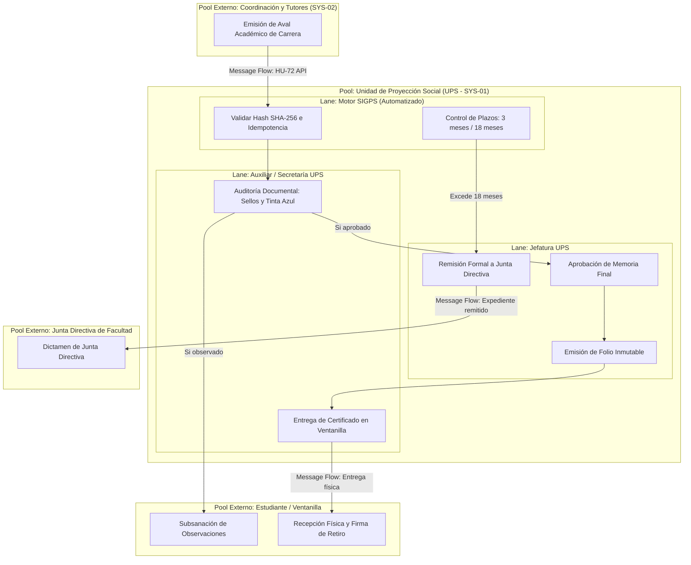
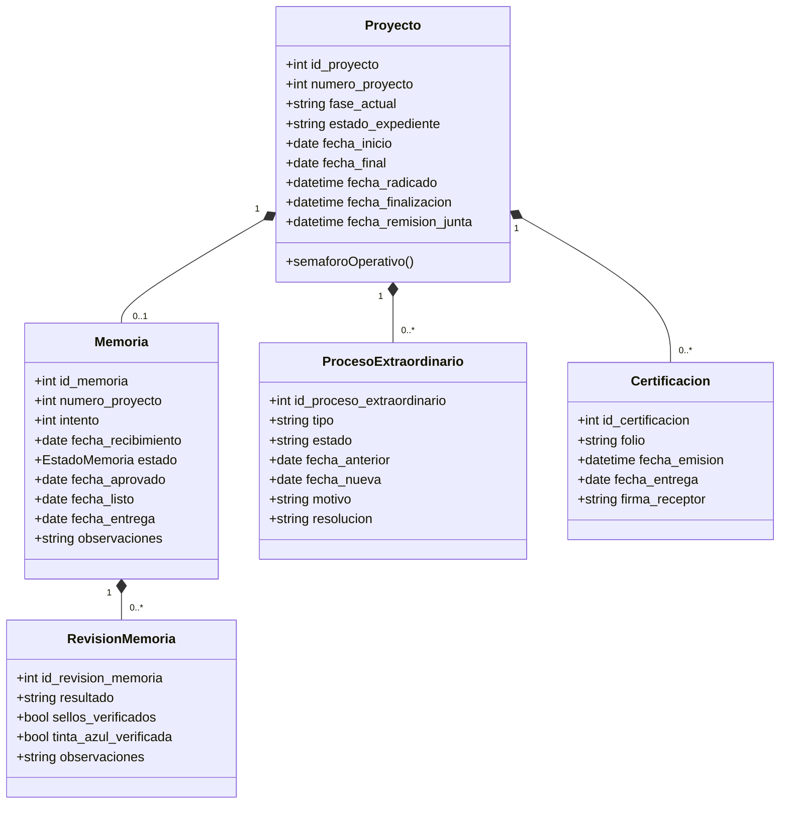
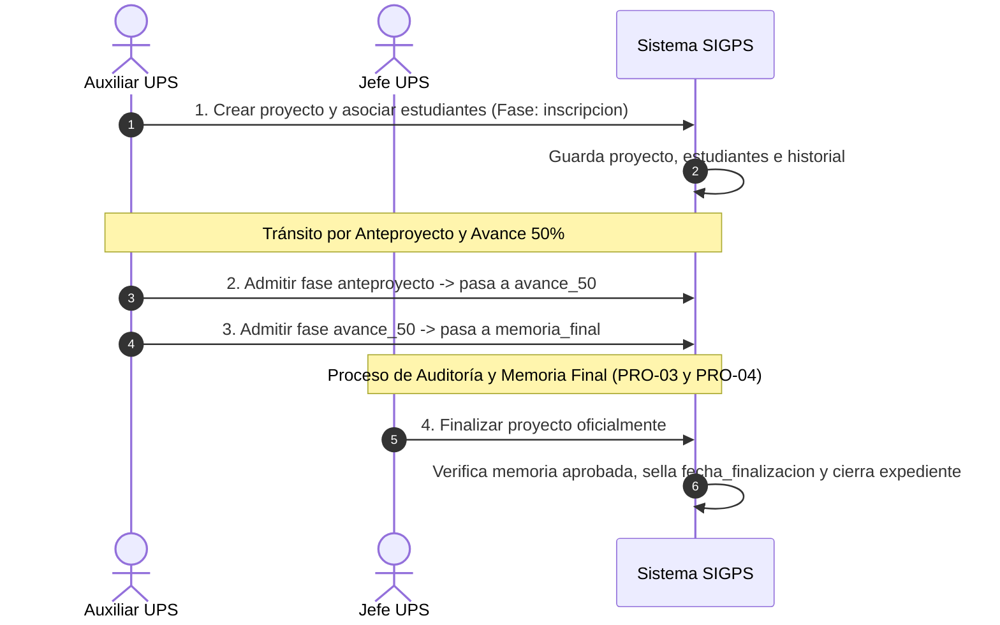
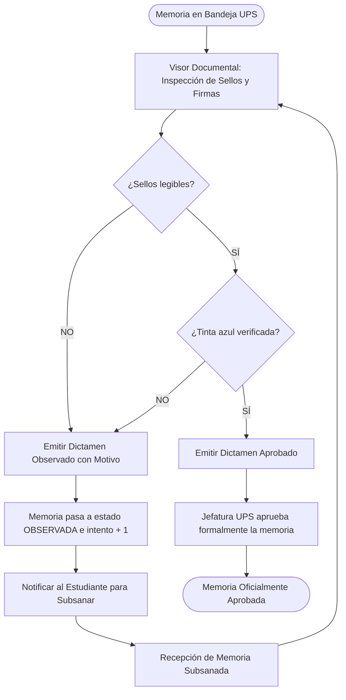
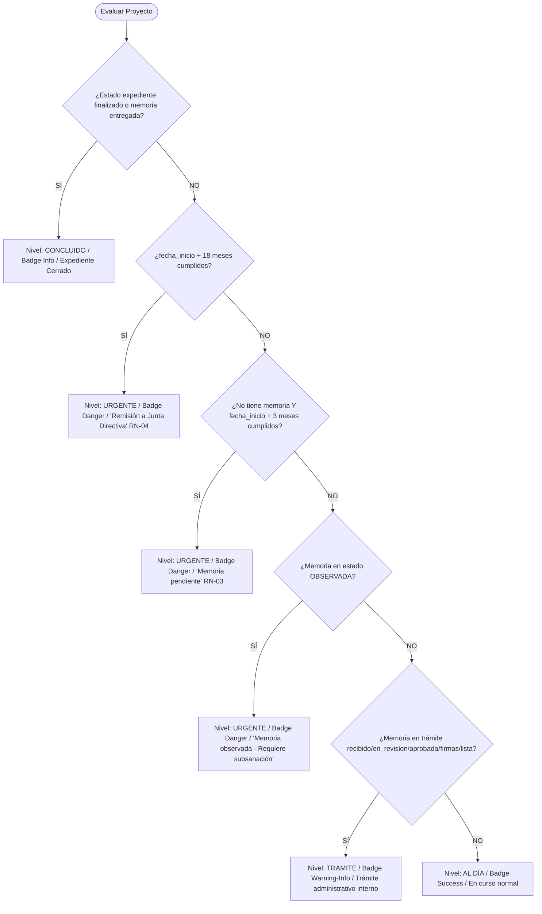

# Especificación de Lógica de Negocio para Modelado BPMN 2.0
## Sistema de Información y Gestión de Proyección Social (SIGPS — Backoffice UPS / SYS-01)
**Facultad Multidisciplinaria Oriental — Universidad de El Salvador (FMO-UES)**

---

## 1. Propósito y Audiencia del Documento

Este documento consolida y formaliza exhaustivamente la **lógica de negocio actual, reglas operativas, actores, entidades, estados y flujos de decisión** del Backoffice de la **Unidad de Proyección Social (UPS — SYS-01)**.

### Objetivo
Servir como la **fuente de verdad canónica (Ground Truth)** para **agentes de Inteligencia Artificial externos** encargados de sintetizar, modelar y generar diagramas de procesos de negocio conformes al estándar **BPMN 2.0 (Business Process Model and Notation)**, ya sea en formato visual, scripts declarativos (Mermaid, PlantUML) o archivos interoperables **BPMN 2.0 XML** para motores de orquestación como Camunda, Zeebe, Signavio o bpmn.io.

---

## 2. Límites del Sistema y Arquitectura de Pools y Lanes ([ADR-06])

> [!IMPORTANT]
> **DELIMITACIÓN ESTRICTA DE FRONTERAS ([ADR-06])**:
> Este sistema corresponde **exclusivamente al Backoffice de la UPS (SYS-01)**. 
> El **Sistema de Coordinadores y Tutores de Carrera (SYS-02)** y el **Portal de Estudiantes (SYS-03)** operan de manera desacoplada e independiente.
> - **SYS-01 NO gestiona** asignación directa de docentes tutores ni el cotejo de control de horas académicas en formularios intermedios (F3 vs. F7). Esas responsabilidades pertenecen a SYS-02.
> - **Punto Único de Enlace**: Endpoint REST de integración `POST /api/v1/integracion/expedientes-avalados` ([HU-72]), mediante el cual SYS-02 transfiere a SYS-01 los paquetes documentales ya avalados para su auditoría física/visual institucional y certificación.

### 2.1 Definición de Pools (Participantes) y Lanes (Roles)

En el modelado BPMN 2.0 se deben estructurar los siguientes participantes:

| Tipo BPMN | Nombre en el Modelo | Identificador | Rol y Alcance Operativo |
|---|---|---|---|
| **Pool Principal (White-Box)** | **Unidad de Proyección Social (UPS - SYS-01)** | `Pool_UPS` | Orquestación interna completa de expedientes, auditoría, plazos y certificaciones. |
| ↳ *Lane Interna 1* | **Jefatura de la UPS** | `Lane_JefeUPS` | Actor `role:jefe_ups`. Resoluciones ejecutivas, aprobación final de memorias, emisión de certificaciones con folio, cancelación de proyectos, remisión a Junta Directiva y administración de catálogos. |
| ↳ *Lane Interna 2* | **Secretaría / Auxiliar UPS** | `Lane_AuxiliarUPS` | Actor `role:auxiliar_ups`. Ventanilla física, registro de participantes, admisión de fases operativas, inspección visual de sellos/tinta azul, y entrega física de certificados. |
| ↳ *Lane Interna 3* | **Motor Backend SIGPS (Sistema)** | `Lane_Sistema` | Tareas automatizadas (`ServiceTask`): validación hash SHA-256, reglas de semaforización de plazos, reloj de vencimientos (3 y 18 meses), disparo de notificaciones e inserciones inmutables en bitácora. |
| **Pool Externo (Black-Box)** | **Sistema de Coordinación y Tutores (SYS-02)** | `Pool_SYS02` | Envía expedientes avalados mediante peticiones firmadas con token de servicio de carrera. Recibe rechazos u observaciones documentales. |
| **Pool Externo (Black-Box)** | **Estudiante / Participante (SYS-03 / Ventanilla)** | `Pool_Estudiante` | Presenta documentación física o consultas; subsana observaciones de auditoría; retira certificación física firmando libro de actas. |
| **Pool Externo (Black-Box)** | **Junta Directiva de Facultad (FMO-UES)** | `Pool_JuntaDirectiva` | Recibe los proyectos extraordinarios que exceden los 18 meses normativos de ejecución para su resolución o prórroga de gobierno universitario. |



---

## 3. Catálogo de Reglas de Negocio (Business Rules Engine)

Las siguientes reglas son de observancia estricta y deben gobernar las condiciones de bifurcación (`Gateways`) y restricciones de tareas en los modelos BPMN:

### [RN-01] Secuencialidad Canónica de Fases del Proyecto
Todo expediente institucional de horas sociales debe transitar estrictamente de forma lineal por cinco fases predefinidas:
1. `inscripcion`: Apertura del expediente y vinculación de participantes.
2. `anteproyecto`: Plan de trabajo avalado por la coordinación académica.
3. `avance_50`: Reporte de ejecución del 50 % de horas reglamentarias.
4. `memoria_final`: Informe de culminación con firmas y sellos institucionales.
5. `finalizacion`: Cierre formal y archivo definitivo del expediente.
*Restricción*: No se permite omitir ni retroceder de fase arbitrariamente. Cada avance requiere admisión formal (`fase_admitida`) registrada con usuario responsable y timestamp.

### [RN-02] Barrera de Aprobación de Memoria Final para Cierre
Un proyecto en fase `memoria_final` no puede ser admitido para pasar a `finalizacion` si su memoria final no se encuentra en alguno de los siguientes estados válidos de culminación: `aprobada`, `aprovada`, `esperando_firmas`, `lista` o `entregada`.

### [RN-03] Regla de Alerta de 3 Meses sin Memoria Radicada
A partir de la `fecha_inicio` del proyecto:
- Si transcurren **3 meses calendario** y el proyecto sigue en trámite sin ninguna memoria registrada en el sistema (`memorias.count == 0`), el estado semafórico pasa automáticamente a nivel **Urgente / Memoria Pendiente**.
- Se activa la acción obligatoria de seguimiento y notificación al estudiante y/o coordinador.

### [RN-04] Regla Crítica de 18 Meses de Ejecución y Remisión a Junta Directiva
- El plazo máximo normativo para la ejecución de un proyecto de proyección social es de **18 meses calendario** a partir de la `fecha_inicio`.
- Al cumplirse 18 meses sin haber finalizado:
  - El expediente adquiere nivel semafórico **Urgente / Remisión a Junta Directiva**.
  - Se bloquea la culminación ordinaria por la UPS.
  - La Jefatura de la UPS (`role:jefe_ups`) debe generar la **Remisión Formal a Junta Directiva**, estampando `fecha_remision_junta` y `remitido_junta_por`.

### [RN-05] Validación Criptográfica e Idempotencia en Integración Externa ([HU-72])
Al recibir un expediente avalado desde `SYS-02`:
1. **Verificación de Integridad**: El hash `archivo_hash_sha256` recibido debe coincidir exactamente con el hash SHA-256 binario calculado del PDF recibido. En caso de discrepancia, se rechaza inmediatamente con error HTTP `422 Unprocessable Content (INTEGRITY_MISMATCH)`.
2. **Idempotencia de Aval**: El `codigo_aval_carrera` no puede haber sido radicado previamente para la misma fase del proyecto. De existir, se rechaza con HTTP `409 Conflict (AVAL_ALREADY_REGISTERED)`.

### [RN-06] Auditoría Visual de Sellos y Tinta Azul ([RN-09] / HU-24 a HU-27)
La auditoría de la memoria final o de los documentos de fase requiere inspección humana de dos condiciones indispensables en el PDF escaneado:
- `sellos_verificados = true` (sellos de la institución beneficiaria y de la coordinación visibles y legibles).
- `tinta_azul_verificada = true` (firmas originales manuscritas realizadas en bolígrafo de tinta azul para garantizar originalidad).
- **Dictamen**:
  - `aprobado`: Si ambas condiciones se cumplen y no hay inconsistencias.
  - `observado`: Si falta algún sello o firma, o existen tachaduras. **Es obligatorio registrar el motivo y las observaciones de subsanación**. La memoria pasa a estado `observada` y el contador de intentos se incrementa (`intento = intento + 1`).

### [RN-07] Unicidad e Inmutabilidad del Folio de Certificación ([HU-33])
- La emisión de la certificación con número de folio institucional es competencia **exclusiva de la Jefatura de la UPS** (`permission:certificaciones.emitir` / `role:jefe_ups`).
- El folio es único en toda la base de datos y no puede editarse una vez asignado.
- Solo se puede emitir certificación a estudiantes formalmente asociados al proyecto que hayan completado sus horas reglamentarias.

### [RN-08] Cierre Automático del Proyecto por Entrega Física
Cuando se registra la entrega física de la memoria final o de la certificación con fecha y firma del estudiante en ventanilla:
- `memoria.estado` pasa a `entregada`.
- `proyecto.fase_actual` pasa a `finalizacion`.
- `proyecto.estado_expediente` pasa a `finalizado`.
- `proyecto.fecha_finalizacion` se sella con el timestamp actual.
- Se registra el evento en `historial_fases_proyecto` y `logs_acciones`.

### [RN-09] Trazabilidad Inmutable en Bitácora Institucional
Toda mutación de estado, admisión de fase, resolución de prórroga, retiro o dictamen de auditoría genera un registro inmutable con usuario responsable, IP/timestamp y detalle en `historial_fases_proyecto` y `logs_acciones`. No existe borrado físico de eventos de auditoría.

### [RN-10] Alcance Temporal en Modificación de Áreas de Conocimiento ([HU-31], [HU-32])
Al editar un área de conocimiento:
- Si el alcance es `retroactivo`: Los cambios impactan a todos los proyectos históricos y vigentes asociados a dicha área.
- Si el alcance es `futuro`: El registro actual del área se desactiva (`activa = false`) preservando la integridad de los proyectos ya iniciados, y se crea un nuevo registro activo que se aplicará únicamente a proyectos futuros.

---

## 4. Entidades de Datos y Ciclos de Vida de Estado

Para el modelado BPMN, las siguientes entidades representan `Data Objects` y `Data Stores` cuyo estado condiciona las compuertas de decisión:



### 4.1 Máquina de Estados de `Proyecto`
- **Estados de Expediente (`estado_expediente`)**:
  - `en_tramite`: Estado activo por defecto. Permite recepciones, auditorías y admisiones de fase.
  - `finalizado`: Estado terminal regular. Expediente cerrado tras entrega de memoria y certificación.
  - `cancelado`: Estado terminal extraordinario. Proyecto cancelado por resolución de Jefatura UPS.
- **Fases del Proyecto (`fase_actual`)**:
  - `inscripcion` ➔ `anteproyecto` ➔ `avance_50` ➔ `memoria_final` ➔ `finalizacion`.

### 4.2 Máquina de Estados de `Memoria`

```mermaid
stateDiagram-v2
    [*] --> recibido: Radicación en ventanilla o API HU-72
    recibido --> en_revision: Inicio de auditoría documental
    en_revision --> observada: Dictamen con fallas (Sellos/Tinta/Contenido)
    observada --> recibido: Subsanación por estudiante/coordinación (Intento + 1)
    en_revision --> aprobada: Dictamen favorable de Jefatura UPS
    aprobada --> esperando_firmas: Envío a proceso de firmas físicas
    esperando_firmas --> lista: Firmas estampadas; retenida en ventanilla
    lista --> entregada: Entrega física y firma de libro
    entregada --> [*]: Cierre y finalización de proyecto
    recibido --> rechazada: Rechazo definitivo irremediable
```


### 4.3 Máquina de Estados de `ProcesoExtraordinario`
- **Tipos (`tipo`)**: `retiro_estudiante`, `cancelacion`, `ampliacion_plazo`, `prorroga`.
- **Estados (`estado`)**:
  - `pendiente`: Solicitud registrada a la espera de resolución de Jefatura (aplica a `ampliacion_plazo`).
  - `aprobada`: Dictamen favorable emitido por Jefatura.
  - `rechazada`: Dictamen desestimado con resolución justificada.
  - `registrado`: Registro directo inmediato sin trámite pendiente (aplica a retiros, cancelaciones y prórrogas directas).

---

## 5. Especificación Exhaustiva de Procesos BPMN 2.0

A continuación se detalla cada proceso de negocio para su mapeo directo a BPMN.

---

### PROCESO 1: Ciclo de Vida General y Admisión de Fases del Proyecto (PRO-01)
*Alcance: Desde la creación del proyecto institucional hasta su cierre.*

- **Pool**: `Unidad de Proyección Social (UPS - SYS-01)`
- **Lanes**: `Lane_AuxiliarUPS`, `Lane_JefeUPS`, `Lane_Sistema`.
- **Start Event**: `StartEvent_SolicitudProyecto` (Apertura de expediente a petición de estudiantes o carrera).
- **Data Objects**: `DO_Proyecto`, `DO_Estudiantes`, `DO_DocumentoInscripcion`.

#### Secuencia de Pasos y Nodos BPMN:
1. **[UserTask - Lane_AuxiliarUPS] Registrar Apertura de Proyecto**:
   - Ingreso de: `numero_proyecto` (correlativo único sugerido por sistema), `titulo`, `fecha_inicio`, `tutor`, `subcoordinador`, `correo_coordinador`, `ubicacion`, `area_de_conocimiento` y vinculación de participantes por carnet (`DUE`).
   - Adjunta documento de inscripción en PDF.
2. **[ServiceTask - Lane_Sistema] Persistir Proyecto e Historial**:
   - Crea `proyectos` con `fase_actual = 'inscripcion'` y `estado_expediente = 'en_tramite'`.
   - Asocia la lista de estudiantes en tabla pivote `proyectos_estudiantes`.
   - Registra en `historial_fases_proyecto` (`fase: inscripcion, evento: fase_admitida`).
3. **[IntermediateCatchEvent - Timer / Message] Espera de Radicación de Siguiente Fase**:
   - El proyecto espera la presentación de la siguiente fase (`anteproyecto`, `avance_50` o `memoria_final`).
4. **[ExclusiveGateway - Gate_FaseActual] Evaluar Fase en Proceso de Admisión**:
   - **Caso `fase_actual in ['inscripcion', 'anteproyecto', 'avance_50']`**:
     - **[UserTask - Lane_AuxiliarUPS / Lane_JefeUPS] Evaluar Documento de Fase**:
       - Revisa el cumplimiento formal de la fase.
       - Si existen observaciones no bloqueantes:
         - **[UserTask] Guardar Observaciones**: Registra notas en `historial_fases_proyecto` sin avanzar fase.
       - Si la fase está completa:
         - **[UserTask] Admitir Fase**: Dispara avance a la siguiente fase canónica (`anteproyecto -> avance_50` o `avance_50 -> memoria_final`).
         - **[ServiceTask - Lane_Sistema] Actualizar Fase y Bitácora**: Actualiza `fase_actual` en el proyecto y guarda evento `fase_admitida`.
   - **Caso `fase_actual == 'memoria_final'`**:
     - Redirige al subproceso **PRO-03 / PRO-04** (Auditoría, Aprobación de Memoria y Certificación).
5. **[ExclusiveGateway - Gate_ListoParaFinalizar] Verificar Condiciones de Cierre ([RN-02])**:
   - Condición: ¿Memoria final aprobada o entregada?
     - **NO**: Error / Bloqueo (HTTP 422). Retorna a revisión.
     - **SÍ**: Permite finalizar.
6. **[UserTask - Lane_JefeUPS] Finalizar Proyecto Oficialmente ([HU-16])**:
   - Solo la Jefatura UPS (`role:jefe_ups`) puede ejecutar la acción `finalizar`.
7. **[ServiceTask - Lane_Sistema] Ejecutar Cierre Transaccional**:
   - `estado_expediente = 'finalizado'`.
   - `fase_actual = 'finalizacion'`.
   - `fecha_finalizacion = now()`.
   - Marca memoria como `entregada` si aún no lo estaba.
   - Registra evento `proyecto_finalizado` en bitácora.
8. **[EndEvent_ProyectoFinalizado]**: Fin del ciclo de vida ordinario.



---

### PROCESO 2: Integración Externa y Radicación de Expediente Avalado (PRO-02 / HU-72)
*Alcance: Recepción vía API Sanctum desde el Sistema de Coordinadores (SYS-02) hacia la bandeja de entrada UPS.*

- **Pool Emisor**: `Sistema de Coordinación y Tutores (SYS-02)` (Pool Externo)
- **Pool Receptor**: `Unidad de Proyección Social (UPS - SYS-01)`
- **Lanes Internas**: `Lane_Sistema`, `Lane_AuxiliarUPS`.
- **Start Event**: `StartEvent_MensajeAPI_HU72` (Llegada de petición HTTP `POST /api/v1/integracion/expedientes-avalados`).
- **Data Object In**: `DO_PayloadMultipart` (`proyecto_id`, `fase`, `codigo_aval_carrera`, `coordinador_firmante`, `archivo_pdf_expediente`, `archivo_hash_sha256`).

#### Secuencia de Pasos y Nodos BPMN:
1. **[ReceiveTask - Lane_Sistema] Recibir Petición con Token de Servicio de Carrera**:
   - Middleware `carrera.token` valida la autenticidad y vigencia de las credenciales de la carrera solicitante.
2. **[ServiceTask - Lane_Sistema] Verificar Integridad Criptográfica ([RN-05])**:
   - Calcula el hash SHA-256 sobre el stream binario de `archivo_pdf_expediente`.
   - Compara contra `archivo_hash_sha256`.
3. **[ExclusiveGateway - Gate_IntegridadHash] ¿Coincide el Hash?**:
   - **NO**:
     - **[SendTask - Lane_Sistema] Responder Error HTTP 422**: `INTEGRITY_MISMATCH`.
     - **[EndEvent_ErrorIntegridad]** (Termina con fallo).
   - **SÍ**: Continúa.
4. **[ServiceTask - Lane_Sistema] Validar Idempotencia de Aval ([RN-05])**:
   - Consulta si `codigo_aval_carrera` ya fue registrado para ese `proyecto_id` y `fase`.
5. **[ExclusiveGateway - Gate_AvalDuplicado] ¿Existe duplicidad?**:
   - **SÍ**:
     - **[SendTask - Lane_Sistema] Responder Error HTTP 409**: `AVAL_ALREADY_REGISTERED`.
     - **[EndEvent_ErrorConflicto]** (Termina con fallo).
   - **NO**: Continúa.
6. **[ServiceTask - Lane_Sistema] Almacenar Archivo y Radicar Expediente**:
   - Guarda el PDF en almacenamiento seguro privado `expedientes_ups/proyectos/{id}/{fase}/`.
   - Registra registro en `documentos_proyecto`.
   - Actualiza `proyecto.fase_actual = fase` y `proyecto.fecha_radicado = now()`.
   - Si `fase == 'memoria_final'`, inicializa o actualiza `memoria` en estado `recibido`.
   - Inserta evento `radicado_ups` en `historial_fases_proyecto`.
7. **[ServiceTask - Lane_Sistema] Disparar Notificaciones Internas**:
   - Envía notificación push / campana a los usuarios de la UPS activos (`jefe_ups` y `auxiliar_ups`).
8. **[SendTask - Lane_Sistema] Retornar Respuesta HTTP 201 Created**:
   - Devuelve `radicado_ups_id`, fecha de radicación y mensaje de confirmación a SYS-02.
9. **[EndEvent_ExpedienteEnBandeja]**: El expediente queda programado en la bandeja de entrada para auditoría física.

---

### PROCESO 3: Auditoría Documental de Sellos y Tinta Azul en Memoria Final (PRO-03 / RN-06 / RN-09)
*Alcance: Inspección visual obligatoria por el personal de la UPS sobre el PDF escaneado.*

- **Pool**: `Unidad de Proyección Social (UPS - SYS-01)`
- **Lanes**: `Lane_AuxiliarUPS` / `Lane_JefeUPS`, `Lane_Sistema`.
- **Start Event**: `StartEvent_ExpedienteEnBandeja` (Memoria final en estado `recibido` o `en_revision`).
- **Data Objects**: `DO_Memoria`, `DO_RevisionMemoria`.

#### Secuencia de Pasos y Nodos BPMN:
1. **[UserTask - Lane_AuxiliarUPS / Lane_JefeUPS] Abrir Visor Documental y Cotejar PDF**:
   - Abre el visor multipágina del expediente.
   - Verifica existencia de firmas y sellos en formularios y memoria.
2. **[ManualTask - Lane_AuxiliarUPS / Lane_JefeUPS] Verificar Factores Físicos Obligatorios ([RN-06])**:
   - Checklist binario:
     1. ¿Sellos institucionales legibles y completos? (`sellos_verificados`).
     2. ¿Firmas originales realizadas en tinta azul? (`tinta_azul_verificada`).
3. **[UserTask - Lane_AuxiliarUPS / Lane_JefeUPS] Emitir Dictamen de Auditoría**:
   - Selecciona resultado: `aprobado` u `observado`.
   - Si `resultado == 'observado'`, redacta observaciones específicas de manera obligatoria.
4. **[ExclusiveGateway - Gate_ResultadoAuditoria] ¿Resultado del Dictamen?**:
   - **Rama OBSERVADO**:
     - **[ServiceTask - Lane_Sistema] Actualizar Estado a Observada**:
       - `memoria.estado = EstadoMemoria::Observada`.
       - Registra `RevisionMemoria` con `resultado = 'observado'`, checks y observaciones.
       - Incrementa contador `intento = intento + 1`.
       - El semáforo del proyecto se torna **Urgente / Memoria observada**.
     - **[SendTask - Lane_AuxiliarUPS] Notificar Subsanación**:
       - Notifica al estudiante o coordinación para corrección física del documento.
     - **[IntermediateCatchEvent - Message] Esperar Nueva Entrega Subsanada**:
       - El estudiante reingresa la memoria corregida (`POST /ups/proyectos/{id}/memoria/recibir`).
       - El estado vuelve a `recibido` y el ciclo regresa al paso 1.
   - **Rama APROBADO**:
     - **[ExclusiveGateway - Gate_RolAuditor] ¿Quién dictaminó?**:
       - **Si fue Auxiliar UPS**: Pasa la memoria a recomendación de aprobación. Jefatura debe ratificar.
       - **Si fue Jefe de UPS** (o ratificado por él):
         - **[ServiceTask - Lane_Sistema] Aprobar Memoria Oficialmente**:
           - `memoria.estado = EstadoMemoria::Aprobada`.
           - `memoria.fecha_aprovado = today()`.
           - Registra en `RevisionMemoria` y bitácora de auditoría.
5. **[EndEvent_MemoriaAprobada]**: La memoria queda apta para el trámite de firmas físicas y certificación.



---

### PROCESO 4: Tramitación de Firmas, Emisión de Certificado con Folio y Entrega (PRO-04)
*Alcance: Desde la memoria aprobada hasta la entrega física de la certificación y cierre definitivo.*

- **Pool**: `Unidad de Proyección Social (UPS - SYS-01)`
- **Lanes**: `Lane_JefeUPS`, `Lane_AuxiliarUPS`, `Lane_Sistema`.
- **Start Event**: `StartEvent_MemoriaAprobada`.
- **Data Objects**: `DO_Memoria`, `DO_Certificacion`.

#### Secuencia de Pasos y Nodos BPMN:
1. **[UserTask - Lane_JefeUPS] Pasar Memoria a Firmas Físicas**:
   - Cambia estado a `esperando_firmas`.
   - Se imprimen documentos oficiales para recolección de firmas de Jefatura y autoridades.
2. **[ManualTask - Recolección de Firmas Físicas]**:
   - Trámite fuera de sistema para la firma manuscrita de autoridades universitarias.
3. **[UserTask - Lane_JefeUPS] Marcar Documento como Listo en Ventanilla**:
   - Tras recolectar firmas, Jefatura cambia el estado de la memoria a `lista` y estampa `fecha_listo`.
   - El documento físico queda retenido en ventanilla de la UPS.
4. **[UserTask - Lane_JefeUPS] Emitir Certificación Oficial con Folio ([HU-33] / [RN-07])**:
   - Exclusivo de Jefatura UPS (`permission:certificaciones.emitir`).
   - Asigna número de `folio` único e inmutable en el libro institucional.
   - Crea registro en `certificaciones` con `fecha_emision = now()`.
5. **[IntermediateCatchEvent - Message] Comparecencia del Estudiante en Ventanilla**:
   - El estudiante acude a la oficina de la UPS a retirar su documento.
6. **[UserTask - Lane_AuxiliarUPS / Lane_JefeUPS] Registrar Entrega Física ([HU-34])**:
   - Auxiliar o Jefe solicita documento de identidad, entrega el certificado y recaba la firma en el libro de actas físico.
   - Ingresa en el sistema: `fecha_entrega` (debe ser `<=` hoy) y `firma_receptor`.
7. **[ServiceTask - Lane_Sistema] Finalización Automática del Proyecto ([RN-08])**:
   - Actualiza `certificacion.fecha_entrega`.
   - Actualiza `memoria.estado = EstadoMemoria::Entregada`.
   - Actualiza `proyecto.fase_actual = 'finalizacion'`.
   - Actualiza `proyecto.estado_expediente = 'finalizado'`.
   - Actualiza `proyecto.fecha_finalizacion = now()`.
   - Registra eventos de auditoría correspondientes.
8. **[EndEvent_ExpedienteCerrado]**: Fin del proceso; estudiante certificado y proyecto archivado.

---

### PROCESO 5: Control de Plazos Normativos, Semaforización y Remisión a Junta Directiva (PRO-05)
*Alcance: Motor continuo de monitoreo de tiempos legales y escalamiento de proyectos vencidos.*

- **Pool**: `Unidad de Proyección Social (UPS - SYS-01)`
- **Lanes**: `Lane_Sistema`, `Lane_JefeUPS`.
- **Start Event**: `StartEvent_CicloCron_Plazos` (Evaluación continua o por cada consulta del tablero de proyectos).
- **Data Objects**: `DO_Proyecto`, `DO_PaqueteRemisionJunta`.

#### Lógica del Semáforo de Operación (`semaforoOperativo()`):
El sistema evalúa el estado del proyecto bajo una jerarquía estricta de gravedad:



#### Flujo de Remisión a Junta Directiva ([RN-04]):
1. **[BoundaryEvent - Timer 18 Meses]**: El reloj del proyecto detecta que `now() >= fecha_inicio + 18 meses`.
2. **[ServiceTask - Lane_Sistema] Marcar Alerta Crítica en Tablero de Plazos**:
   - Proyecto ingresa al listado prioritario de remisión a Junta Directiva.
3. **[UserTask - Lane_JefeUPS] Generar Remisión Formal a Junta Directiva ([HU-23])**:
   - Jefatura revisa el historial del expediente.
   - Ejecuta `POST /ups/plazos/{proyectoId}/remitir-junta`.
4. **[ServiceTask - Lane_Sistema] Bloquear Proyecto y Generar Radicado de Remisión**:
   - `proyecto.fecha_remision_junta = now()`.
   - `proyecto.remitido_junta_por = auth()->id()`.
   - Genera ficha imprimible formal con el resumen cronológico de incumplimiento de plazos.
5. **[SendTask - Lane_JefeUPS] Enviar Paquete a Junta Directiva (Pool Externo)**:
   - Remisión física o institucional del expediente al cuerpo directivo de la facultad.
6. **[EndEvent_RemitidoJuntaDirectiva]**: El expediente queda a la espera del dictamen superior de Junta Directiva.

---

### PROCESO 6: Gestión de Procesos Extraordinarios (PRO-06)
*Alcance: Alteraciones extraordinarias a la composición o vigencia del proyecto.*

Este proceso contiene cuatro caminos de ejecución mutuamente excluyentes o complementarios:

```mermaid
flowchart TD
    Ext_Start([Solicitud de Trámite Extraordinario]) --> Ext_Gateway{¿Tipo de Proceso?}
    
    Ext_Gateway -->|Retiro de Estudiante| PE_Retiro[Desvincular estudiante de la tabla pivote con justificación obligatoria]
    Ext_Gateway -->|Cancelación| PE_Cancela[Jefatura cancela proyecto definitivamente con motivo]
    Ext_Gateway -->|Ampliación de Plazo| PE_Amplia[Auxiliar registra solicitud con fecha nueva > fecha actual y PDF]
    Ext_Gateway -->|Prórroga Extraordinaria| PE_Prorroga[Jefatura registra prórroga con número de acuerdo/autorización]
    
    PE_Retiro --> Reg_Retiro[Registra Proceso Extraordinario 'registrado' + Historial]
    PE_Cancela --> Reg_Cancela[estado_expediente = 'cancelado' + fecha_finalizacion = now()]
    
    PE_Amplia --> Estado_Pendiente[Proceso Extraordinario 'pendiente' en Bandeja de Prórrogas]
    Estado_Pendiente --> Resuelve_Jefe{Jefatura Resuelve}
    Resuelve_Jefe -- Aprobada --> Aprueba_Amp[Actualiza fecha_final del proyecto a fecha_nueva]
    Resuelve_Jefe -- Rechazada --> Rechaza_Amp[Mantiene fecha_final anterior y registra resolución]
    
    PE_Prorroga --> Directo_Prorroga[Actualiza fecha_final del proyecto de inmediato]
```

#### 6.1 Subproceso: Retiro Formal de Estudiante ([HU-19])
1. **[UserTask - Lane_AuxiliarUPS / Lane_JefeUPS] Solicitar Retiro**:
   - Selecciona el estudiante participante y redacta motivo obligatorio (`min:10` caracteres).
2. **[ServiceTask - Lane_Sistema] Desvincular Participante**:
   - Valida que el proyecto esté `en_tramite` y el estudiante esté activo en él.
   - Crea `procesos_extraordinarios` (`tipo: retiro_estudiante, estado: registrado`).
   - Remueve relación de `proyectos_estudiantes`.
   - Registra evento `estudiante_retirado` en `historial_fases_proyecto`.
3. **[EndEvent_EstudianteRetirado]**.

#### 6.2 Subproceso: Cancelación Definitiva de Proyecto ([HU-20])
1. **[UserTask - Lane_JefeUPS] Solicitar Cancelación Definitiva**:
   - Exclusivo de Jefatura UPS (`role:jefe_ups`).
   - Justificación institucional detallada obligatoria (`min:10` caracteres).
2. **[ServiceTask - Lane_Sistema] Cancelar y Sellar Expediente**:
   - Actualiza `proyecto.estado_expediente = 'cancelado'`.
   - Asigna `proyecto.fecha_finalizacion = now()`.
   - Registra en `procesos_extraordinarios` (`tipo: cancelacion, estado: registrado`).
   - Registra evento `proyecto_cancelado` en historial.
3. **[EndEvent_ProyectoCancelado]** (Cierre anticipado del proceso).

#### 6.3 Subproceso: Solicitud y Resolución de Ampliación de Plazo ([HU-21])
1. **[UserTask - Lane_AuxiliarUPS] Registrar Solicitud de Ampliación**:
   - Ingresa: `fecha_nueva` (debe ser estrictamente posterior a `fecha_final` o `fecha_inicio`), `motivo` y adjunta PDF de respaldo opcional.
2. **[ServiceTask - Lane_Sistema] Crear Proceso en Estado Pendiente**:
   - Inserta en `procesos_extraordinarios` (`tipo: ampliacion_plazo, estado: pendiente`).
   - Almacena PDF en disco de expedientes.
3. **[UserTask - Lane_JefeUPS] Dictaminar Solicitud en Bandeja de Prórrogas**:
   - Requiere permiso `prorrogas.resolver`.
   - Dictamina: `aprobada` o `rechazada`, redactando la resolución formal obligatoria.
4. **[ExclusiveGateway - Gate_DictamenAmpliacion] ¿Resolución?**:
   - **Aprobada**:
     - `proceso.estado = 'aprobada'`.
     - `proyecto.fecha_final = proceso.fecha_nueva`.
     - Registra evento `ampliacion_aprobada` en historial.
   - **Rechazada**:
     - `proceso.estado = 'rechazada'`.
     - Mantiene intacta la fecha final anterior.
     - Registra evento `ampliacion_rechazada` en historial.
5. **[EndEvent_AmpliacionResuelta]**.

#### 6.4 Subproceso: Registro Directo de Prórroga Extraordinaria ([HU-22])
1. **[UserTask - Lane_JefeUPS] Registrar Prórroga Ejecutiva**:
   - Exclusivo de Jefatura UPS (`permission:prorrogas.resolver`).
   - Ingresa: `fecha_nueva`, `autorizacion` (número de acuerdo institucional o resolución) y motivo.
2. **[ServiceTask - Lane_Sistema] Aplicar Prórroga Inmediata**:
   - Actualiza `proyecto.fecha_final = fecha_nueva`.
   - Inserta `procesos_extraordinarios` (`tipo: prorroga, estado: aprobada`).
   - Registra evento `prorroga_registrada` en historial de fases.
3. **[EndEvent_ProrrogaRegistrada]**.

---

### PROCESO 7: Administración de Catálogos Institucionales (PRO-07)
*Alcance: Configuración maestra operada por Jefatura de la UPS.*

#### 7.1 Gestión de Áreas de Conocimiento y Regla de Alcance Temporal ([RN-10] / HU-28 a HU-32)
1. **[UserTask - Lane_JefeUPS] Actualizar Área de Conocimiento**:
   - Modifica nombre y detalles del área.
   - Selecciona obligatoriamente el parámetro `alcance`: `retroactivo` o `futuro`.
2. **[ExclusiveGateway - Gate_AlcanceArea] ¿Alcance seleccionado?**:
   - **Retroactivo**:
     - **[ServiceTask]** Actualiza directamente el registro en `areas_de_conocimiento`.
     - El cambio surte efecto en todos los proyectos históricos y futuros vinculados a esa ID.
   - **Futuro**:
     - **[ServiceTask]** Marca el registro existente como inactivo: `activa = false`.
     - Crea un nuevo registro en `areas_de_conocimiento` con los nuevos datos y `activa = true`.
     - Los proyectos existentes continúan apuntando al área histórica sin alteraciones; los nuevos proyectos utilizarán la versión recién creada.
3. **[EndEvent_AreaActualizada]**.

#### 7.2 Gestión y Versionado de Plantillas Oficiales F1 a F8 ([HU-40] a [HU-43])
1. **[UserTask - Lane_JefeUPS] Cargar o Actualizar Plantilla Oficial**:
   - Define nombre, tipo (`archivo_ejemplo` o `autorellenable`) y sube archivo (PDF, DOCX, XLSX).
2. **[ServiceTask - Lane_Sistema] Versionar Documento**:
   - Almacena el archivo en almacenamiento público accesible (`formatos-oficiales/`).
   - Si la plantilla ya existía: despublica la versión anterior (`publicada = false`) e inserta una nueva versión con `numero_version = n + 1` y `publicada = true`.
3. **[BoundaryEvent - Acceso Público]**:
   - Estudiantes y Coordinadores (SYS-02 y SYS-03) consultan y descargan libremente los formatos vigentes vía `GET /api/v1/formatos` y `GET /formatos-oficiales/{id}/descargar`.
4. **[EndEvent_PlantillaPublicada]**.

---

## 6. Guía de Implementación para Agentes de IA Generadores de BPMN

Cuando un agente externo genere diagramas BPMN a partir de esta especificación, debe cumplir las siguientes pautas técnicas:

### 6.1 Mapeo de Nomenclatura BPMN 2.0 XML
| Concepto de Dominio | Elemento XML BPMN 2.0 | Atributo / Convención |
|---|---|---|
| Acción realizada por Auxiliar o Jefe en UI | `<bpmn:userTask>` | `name="Verbo en infinitivo + Objeto"` (ej. `Admitir fase del proyecto`) |
| Operación automática de BD / Criptografía | `<bpmn:serviceTask>` | `name="Validar hash SHA-256 e idempotencia"` |
| Inspección física o firmas fuera de pantalla | `<bpmn:manualTask>` | `name="Verificar sellos y firmas en tinta azul"` |
| Envío de notificación o respuesta HTTP | `<bpmn:sendTask>` | `name="Notificar estudiante sobre observaciones"` |
| Recepción de llamada API externa | `<bpmn:receiveTask>` | `name="Recibir paquete avalado de SYS-02"` |
| Decisiones dicotómicas (Aprobado / Observado) | `<bpmn:exclusiveGateway>` | Pregunta explícita en label (ej. `¿Dictamen conforme?`) |
| Vencimiento de plazo (3 o 18 meses) | `<bpmn:intermediateCatchEvent>` o `<bpmn:boundaryEvent>` | Sub-elemento `<bpmn:timerEventDefinition>` con ISO 8601 o expresión temporal |
| Comunicación entre SYS-01 y SYS-02 / Estudiante | `<bpmn:messageFlow>` | Conecta bordes de Pools independientes |
| Estado de una entidad en el flujo | `<bpmn:dataObjectReference>` | Vinculado a `<bpmn:dataState name="estado">` |

### 6.2 Convenciones de Diseño y Buenas Prácticas BPMN
1. **Direccionalidad**: Los flujos de secuencia (`sequenceFlow`) deben fluir predominantemente de izquierda a derecha dentro de cada Lane.
2. **Conexiones Inter-Pools**: **Nunca** conectar una secuencia directa (`sequenceFlow`) de una Lane de un Pool a otro Pool distinto. La interacción entre el Pool UPS y Pools externos (SYS-02, Estudiante, Junta Directiva) debe modelarse exclusivamente mediante **Flujos de Mensaje (`messageFlow`)**.
3. **Terminaciones**: Todo camino de ejecución debe confluir en un `EndEvent` descriptivo (ej. `Proyecto finalizado`, `Expediente cancelado`, `Error criptográfico descartado`).
4. **Transacciones Atómicas**: Las operaciones críticas (como la admisión de fase, entrega de certificación o dictamen de auditoría) se ejecutan dentro de transacciones de base de datos (`DB::transaction`). Si un agente modela a nivel micro, puede representarlas como un `<bpmn:subProcess>` con el atributo `triggeredByEvent="false"` o de tipo Transaction.

---

## 7. Glosario de Términos del Dominio

- **UPS**: Unidad de Proyección Social de la FMO-UES (SYS-01).
- **SYS-02**: Sistema informático externo que asiste a las coordinaciones de carrera y docentes tutores.
- **SYS-03**: Portal web estudiantil de servicio social.
- **DUE**: Documento Único Estudiantil (carnet universitario de la UES).
- **Aval Académico**: Dictamen emitido por la coordinación de carrera certificando el cumplimiento del anteproyecto, horas o memoria antes de su envío a la UPS.
- **Tinta Azul**: Disposición reglamentaria que exige firmas manuscritas con tinta azul en las memorias físicas escaneadas para certificar originalidad.
- **Folio**: Identificador alfanumérico institucional único asentado en los libros oficiales de actas de servicio social.
- **Junta Directiva**: Máxima autoridad ejecutiva de la facultad, competente para dictaminar sobre proyectos con más de 18 meses de rezago.

